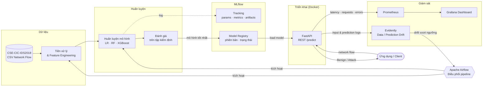
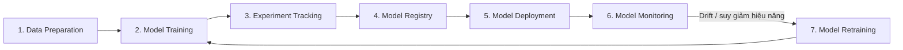

# CyberMLOps – MLOps Pipeline for Cybersecurity Intrusion Detection

> Xây dựng một hệ thống MLOps hoàn chỉnh cho bài toán **phát hiện xâm nhập mạng (Intrusion Detection)** trên bộ dữ liệu **CSE-CIC-IDS2018**, quản lý toàn bộ vòng đời mô hình học máy: từ tiền xử lý dữ liệu, huấn luyện, đánh giá đến triển khai, giám sát và tái huấn luyện.


> **Trạng thái:** Dự án đang ở giai đoạn **đề xuất (proposal)**. Các thành phần, công cụ và cấu trúc thư mục mô tả bên dưới là thiết kế dự kiến và có thể được điều chỉnh trong quá trình triển khai.

---

## Mục lục

1. [Thông tin đề tài](#1-thông-tin-đề-tài)
2. [Bối cảnh và mục tiêu](#2-bối-cảnh-và-mục-tiêu)
3. [Kiến trúc hệ thống](#3-kiến-trúc-hệ-thống)
4. [Công nghệ sử dụng](#4-công-nghệ-sử-dụng)
5. [Dữ liệu](#5-dữ-liệu)
6. [Mô hình và tiêu chí đánh giá](#6-mô-hình-và-tiêu-chí-đánh-giá)
7. [Quy trình MLOps](#7-quy-trình-mlops)
8. [Giám sát và tái huấn luyện](#8-giám-sát-và-tái-huấn-luyện)
9. [Cấu trúc thư mục dự kiến](#9-cấu-trúc-thư-mục-dự-kiến)
10. [Lộ trình thực hiện](#10-lộ-trình-thực-hiện)
11. [Kết quả kỳ vọng](#11-kết-quả-kỳ-vọng)
12. [Hướng mở rộng](#12-hướng-mở-rộng)
13. [Tài liệu tham khảo](#13-tài-liệu-tham-khảo)

---

## 1. Thông tin đề tài

| Hạng mục | Nội dung |
|---|---|
| **Tên đề tài** | CyberMLOps – Xây dựng hệ thống MLOps cho bài toán phát hiện tấn công mạng |
| **Lĩnh vực** | An ninh mạng, Vận hành hệ thống học máy (MLOps) |
| **Dataset** | CSE-CIC-IDS2018 |
| **Mô hình chính** | XGBoost |
| **Framework MLOps** | MLflow |
| **Môi trường phát triển** | Python, Jupyter Notebook, Docker, FastAPI |
| **Quản lý mã nguồn** | Git, GitHub |

---

## 2. Bối cảnh và mục tiêu

### 2.1. Bối cảnh

Hệ thống phát hiện xâm nhập (IDS) dựa trên học máy thường đạt kết quả tốt trong môi trường thí nghiệm, nhưng gặp nhiều khó khăn khi đưa vào vận hành thực tế:

- Kết quả huấn luyện **khó tái lập** do thiếu quản lý cấu hình, dữ liệu và phiên bản mô hình.
- Lưu lượng mạng và hành vi tấn công **thay đổi liên tục theo thời gian**, khiến phân phối dữ liệu bị lệch (Data Drift) và hiệu năng mô hình suy giảm.
- Thiếu quy trình chuẩn để **triển khai, giám sát và cập nhật** mô hình một cách an toàn.

Dự án áp dụng các nguyên tắc MLOps để giải quyết những vấn đề này, qua đó minh họa vai trò của MLOps trong việc nâng cao **khả năng tái lập, tính ổn định, khả năng bảo trì và độ tin cậy** của các hệ thống học máy trong lĩnh vực an ninh mạng.

### 2.2. Mục tiêu

Hệ thống phân loại lưu lượng mạng thành **lưu lượng bình thường** và **lưu lượng độc hại**, với các mục tiêu cụ thể:

1. **Phát hiện tấn công** — Xây dựng mô hình học máy có khả năng phát hiện lưu lượng mạng độc hại và nhận diện các hành vi tấn công.
2. **Huấn luyện có khả năng tái lập** — Thiết kế quy trình huấn luyện hỗ trợ theo dõi thí nghiệm, quản lý phiên bản mô hình và đánh giá hiệu năng.
3. **Triển khai nhất quán** — Cung cấp mô hình dưới dạng REST API, đóng gói bằng Docker để đảm bảo tính nhất quán của môi trường vận hành.
4. **Giám sát vận hành** — Theo dõi Data Drift, phân phối dự đoán và hiệu năng mô hình trong quá trình vận hành.
5. **Tái huấn luyện** — Cập nhật mô hình khi phát hiện hiệu năng suy giảm hoặc dữ liệu thay đổi đáng kể.

---

## 3. Kiến trúc hệ thống

MLflow đóng vai trò **trung tâm** trong quản lý thí nghiệm và phiên bản mô hình. Các công cụ còn lại hỗ trợ tự động hóa quy trình, triển khai dịch vụ và giám sát hệ thống trong suốt vòng đời mô hình.



---

## 4. Công nghệ sử dụng

| Thành phần | Công cụ | Vai trò trong hệ thống |
|---|---|---|
| Ngôn ngữ & môi trường | Python, Jupyter Notebook | Khám phá dữ liệu, thử nghiệm và phát triển pipeline |
| Mô hình | XGBoost, scikit-learn | Mô hình chính và các mô hình đối chứng |
| Theo dõi thí nghiệm | **MLflow Tracking** | Lưu siêu tham số, chỉ số đánh giá, kết quả huấn luyện và artifacts của từng thí nghiệm; so sánh cấu hình để chọn mô hình tốt nhất |
| Quản lý mô hình | **MLflow Model Registry** | Quản lý phiên bản, thông tin và trạng thái mô hình; hỗ trợ đánh giá, đăng ký và đưa mô hình vào triển khai |
| Phục vụ mô hình | **FastAPI** | REST API cho phép ứng dụng bên ngoài gửi dữ liệu lưu lượng mạng và nhận kết quả phát hiện tấn công |
| Đóng gói | **Docker** | Đóng gói ứng dụng, mô hình và thư viện phụ thuộc thành container, đảm bảo nhất quán và dễ tái triển khai |
| Giám sát dữ liệu | **Evidently** | Giám sát thay đổi phân phối đặc trưng đầu vào và kết quả dự đoán, phát hiện Data Drift, tạo báo cáo |
| Điều phối | **Apache Airflow** | Điều phối các pipeline xử lý dữ liệu, huấn luyện, đánh giá và tái huấn luyện theo lịch hoặc theo điều kiện giám sát |
| Giám sát vận hành | **Prometheus + Grafana** | Thu thập và trực quan hóa chỉ số vận hành: độ trễ dự đoán, số lượng yêu cầu, thông lượng, tỷ lệ lỗi |
| Quản lý mã nguồn | Git, GitHub | Quản lý phiên bản mã nguồn và cộng tác |

---

## 5. Dữ liệu

### 5.1. Bộ dữ liệu CSE-CIC-IDS2018

**CSE-CIC-IDS2018** là bộ dữ liệu an ninh mạng công khai do Communications Security Establishment (CSE) và Canadian Institute for Cybersecurity (CIC) xây dựng, phục vụ nghiên cứu phát hiện xâm nhập. Dữ liệu được thu thập trong **môi trường doanh nghiệp mô phỏng**, gồm lưu lượng bình thường và nhiều loại tấn công:

| Nhóm tấn công | Mô tả ngắn |
|---|---|
| Brute Force | Dò mật khẩu trên các dịch vụ như FTP, SSH |
| DoS | Tấn công từ chối dịch vụ từ một nguồn |
| DDoS | Tấn công từ chối dịch vụ phân tán |
| Botnet | Lưu lượng từ các máy bị chiếm quyền điều khiển |
| Web Attacks | Tấn công ứng dụng web (ví dụ: SQL Injection, XSS, brute force web) |
| Infiltration | Xâm nhập từ bên trong mạng nội bộ |

Dự án sử dụng các **tệp CSV đã trích xuất đặc trưng ở mức luồng mạng (Network Flow)**, với các thuộc tính như thời lượng kết nối, số gói tin gửi/nhận, độ dài gói tin, tốc độ truyền dữ liệu và thông tin giao thức.

> Dataset có thể được điều chỉnh hoặc bổ sung trong quá trình triển khai, tùy thuộc vào chất lượng dữ liệu, tài nguyên tính toán và yêu cầu thực tế của dự án.

### 5.2. Tiền xử lý

1. **Làm sạch dữ liệu** — xử lý giá trị thiếu, giá trị vô hạn (`inf`) và bản ghi trùng lặp.
2. **Chuẩn hóa cấu trúc** — thống nhất tên cột và kiểu dữ liệu của các đặc trưng giữa các tệp.
3. **Lựa chọn đặc trưng** — giữ lại các đặc trưng phù hợp với bài toán phát hiện xâm nhập.
4. **Mã hóa nhãn & xử lý mất cân bằng** — mã hóa nhãn và áp dụng kỹ thuật cân bằng lớp.
5. **Chia tập dữ liệu** — tách tập huấn luyện, kiểm định và kiểm tra.

### 5.3. Phạm vi bài toán

| Giai đoạn | Bài toán | Nhãn |
|---|---|---|
| Ban đầu | Phân loại nhị phân (Binary Classification) | `Benign` / `Attack` |
| Mở rộng | Phân loại đa lớp (Multiclass Classification) | Từng loại hình tấn công cụ thể |

### 5.4. Chia dữ liệu theo thời gian

Để mô phỏng môi trường vận hành thực tế, dữ liệu dự kiến được chia **theo ngày hoặc giai đoạn thu thập** (nếu có thông tin thời gian). Cách tiếp cận này cho phép:

- Đánh giá khả năng **tổng quát hóa** của mô hình trên dữ liệu ở các giai đoạn khác nhau.
- Tạo các kịch bản thực nghiệm cho việc **phát hiện Data Drift** và theo dõi **suy giảm hiệu năng**.

---

## 6. Mô hình và tiêu chí đánh giá

### 6.1. Các mô hình

| Mô hình | Vai trò |
|---|---|
| Logistic Regression | Mô hình cơ sở (Baseline) cho bài toán phân loại nhị phân |
| Random Forest | Mô hình đối chứng dựa trên tập hợp cây quyết định |
| **XGBoost** | **Mô hình chính** được lựa chọn để huấn luyện, triển khai và giám sát |

**Lý do chọn XGBoost** (Extreme Gradient Boosting — dựa trên Gradient Boosted Decision Trees):

- Hiệu năng tốt trên **dữ liệu dạng bảng (Tabular Data)** như dữ liệu lưu lượng mạng.
- Mô hình hóa tốt các **mối quan hệ phi tuyến**.
- Tốc độ huấn luyện tương đối hiệu quả.
- Tích hợp sẵn với **MLflow** để theo dõi thí nghiệm và quản lý mô hình.

### 6.2. Chỉ số đánh giá

| Chỉ số | Ý nghĩa |
|---|---|
| Precision | Tỷ lệ cảnh báo tấn công là đúng |
| **Recall** | Tỷ lệ cuộc tấn công thực tế được phát hiện — **ưu tiên cao** |
| F1-score | Cân bằng giữa Precision và Recall |
| ROC-AUC | Khả năng phân tách lớp trên mọi ngưỡng |
| PR-AUC | Phù hợp hơn ROC-AUC khi dữ liệu mất cân bằng |
| **False Positive Rate** | Tỷ lệ cảnh báo nhầm trên lưu lượng bình thường — **ưu tiên cao** |
| Confusion Matrix | Phân tích chi tiết các loại lỗi |

Với hệ thống IDS, **bỏ sót tấn công** (Recall thấp) và **cảnh báo nhầm quá nhiều** (FPR cao) đều gây hậu quả nghiêm trọng, nên hai chỉ số này được đặc biệt chú trọng.

### 6.3. Lựa chọn mô hình

Mô hình có kết quả tốt nhất trên tập kiểm định sẽ được **đăng ký trên MLflow Model Registry** và triển khai thành dịch vụ dự đoán.

---

## 7. Quy trình MLOps



| # | Giai đoạn | Mô tả | Công cụ |
|---|---|---|---|
| 1 | **Chuẩn bị dữ liệu** (Data Preparation) | Thu thập, kiểm tra tính hợp lệ, làm sạch và tiền xử lý dữ liệu CSE-CIC-IDS2018 | Python, Pandas |
| 2 | **Huấn luyện mô hình** (Model Training) | Huấn luyện các mô hình đề xuất và đánh giá trên tập kiểm định | scikit-learn, XGBoost |
| 3 | **Theo dõi thí nghiệm** (Experiment Tracking) | Ghi nhận siêu tham số, chỉ số đánh giá, cấu hình và kết quả của từng lần huấn luyện | MLflow Tracking |
| 4 | **Quản lý mô hình** (Model Registry) | Đăng ký, quản lý phiên bản và theo dõi trạng thái mô hình được chọn | MLflow Model Registry |
| 5 | **Triển khai mô hình** (Model Deployment) | Đóng gói bằng Docker và cung cấp REST API | Docker, FastAPI |
| 6 | **Giám sát mô hình** (Model Monitoring) | Theo dõi phân phối đầu vào, phân phối dự đoán, Data Drift, độ trễ suy luận và hiệu năng vận hành | Evidently, Prometheus, Grafana |
| 7 | **Tái huấn luyện** (Model Retraining) | Kích hoạt khi thỏa điều kiện Drift hoặc suy giảm hiệu năng; mô hình mới được đánh giá trước khi đăng ký và thay thế mô hình hiện tại | Apache Airflow, MLflow |

---

## 8. Giám sát và tái huấn luyện

### 8.1. Các lớp giám sát

| Lớp | Nội dung theo dõi | Công cụ |
|---|---|---|
| Dữ liệu | Thay đổi phân phối đặc trưng đầu vào (Data Drift) | Evidently |
| Dự đoán | Thay đổi phân phối kết quả dự đoán (Prediction Drift) | Evidently |
| Mô hình | Precision, Recall, F1, FPR khi có nhãn thực tế | Evidently, MLflow |
| Hệ thống | Độ trễ dự đoán, số yêu cầu, thông lượng, tỷ lệ lỗi | Prometheus, Grafana |

### 8.2. Vòng lặp tái huấn luyện

1. Evidently phát hiện Drift hoặc hiệu năng giảm dưới ngưỡng.
2. Airflow kích hoạt pipeline tái huấn luyện với dữ liệu mới.
3. Mô hình mới được ghi nhận trên MLflow và **so sánh với mô hình đang chạy**.
4. Chỉ khi mô hình mới tốt hơn, nó mới được đăng ký phiên bản mới và triển khai thay thế.

Dự án sẽ thực hiện các thí nghiệm so sánh **định lượng** hiệu năng giữa mô hình ban đầu và mô hình sau tái huấn luyện trong các kịch bản dữ liệu thay đổi.

---

## 9. Cấu trúc thư mục dự kiến

```text
CIC-IDS-MLOps/
├── data/
│   ├── raw/                # Raw CSE-CIC-IDS2018 CSV files (not committed)
│   └── processed/          # Preprocessed data
├── notebooks/              # Jupyter Notebooks: EDA, model experiments
├── src/
│   ├── data/               # Data loading, cleaning, preprocessing
│   ├── features/           # Feature selection and transformation
│   ├── models/             # Model training, evaluation, registration
│   ├── api/                # FastAPI app serving predictions
│   └── monitoring/         # Drift reports (Evidently), metrics (Prometheus)
├── pipelines/
│   └── airflow/dags/       # DAGs orchestrating training & retraining
├── deploy/
│   ├── docker/             # Dockerfiles for API, MLflow, ...
│   ├── prometheus/         # Prometheus configuration
│   └── grafana/            # Grafana dashboards
├── tests/                  # Tests
├── docker-compose.yml
├── requirements.txt
└── README.md
```

> Cấu trúc trên là định hướng ban đầu và sẽ được cập nhật theo tiến độ thực tế.

---

## 10. Lộ trình thực hiện

- [ ] **Giai đoạn 1 — Dữ liệu:** tải dataset, EDA, xây dựng pipeline tiền xử lý
- [ ] **Giai đoạn 2 — Mô hình:** huấn luyện Logistic Regression, Random Forest, XGBoost; tích hợp MLflow Tracking
- [ ] **Giai đoạn 3 — Registry & Serving:** đăng ký mô hình trên MLflow Model Registry; xây dựng FastAPI; đóng gói Docker
- [ ] **Giai đoạn 4 — Giám sát:** tích hợp Evidently, Prometheus, Grafana
- [ ] **Giai đoạn 5 — Tự động hóa:** xây dựng DAG Airflow cho huấn luyện và tái huấn luyện
- [ ] **Giai đoạn 6 — Thực nghiệm:** mô phỏng Drift theo thời gian, so sánh mô hình trước và sau tái huấn luyện
- [ ] **Mở rộng:** phân loại đa lớp theo loại hình tấn công

---

## 11. Kết quả kỳ vọng

Sau khi hoàn thành, dự án kỳ vọng xây dựng được một **hệ thống MLOps thử nghiệm** cho bài toán phát hiện xâm nhập mạng, đáp ứng:

- ✅ Quy trình huấn luyện và đánh giá mô hình **có khả năng tái lập**.
- ✅ Theo dõi tập trung các thí nghiệm và **quản lý phiên bản mô hình** bằng MLflow.
- ✅ Mô hình được **triển khai dưới dạng REST API** trong môi trường Docker.
- ✅ Hệ thống **giám sát hiệu năng** và phát hiện thay đổi phân phối dữ liệu.
- ✅ Quy trình **điều phối tái huấn luyện** và đánh giá mô hình mới.
- ✅ **So sánh định lượng** hiệu năng mô hình trước và sau tái huấn luyện trong các kịch bản dữ liệu thay đổi.

---

## 12. Hướng mở rộng

- **Apache Kafka** — thu thập và xử lý lưu lượng mạng theo thời gian thực (streaming).
- **Apache Spark** — xử lý dữ liệu phân tán cho khối lượng lớn.
- **Triển khai có khả năng mở rộng** — đưa hệ thống vào môi trường gần với thực tế hơn.
- **Phân loại đa lớp** — xác định cụ thể từng loại hình tấn công.

---

## 13. Tài liệu tham khảo

- CSE-CIC-IDS2018 Dataset — Canadian Institute for Cybersecurity: <https://www.unb.ca/cic/datasets/ids-2018.html>
- I. Sharafaldin, A. H. Lashkari, A. A. Ghorbani, *"Toward Generating a New Intrusion Detection Dataset and Intrusion Traffic Characterization"*, ICISSP 2018.
- MLflow: <https://mlflow.org/docs/latest/>
- XGBoost: <https://xgboost.readthedocs.io/>
- FastAPI: <https://fastapi.tiangolo.com/>
- Evidently: <https://docs.evidentlyai.com/>
- Apache Airflow: <https://airflow.apache.org/docs/>
- Prometheus: <https://prometheus.io/docs/> · Grafana: <https://grafana.com/docs/>

