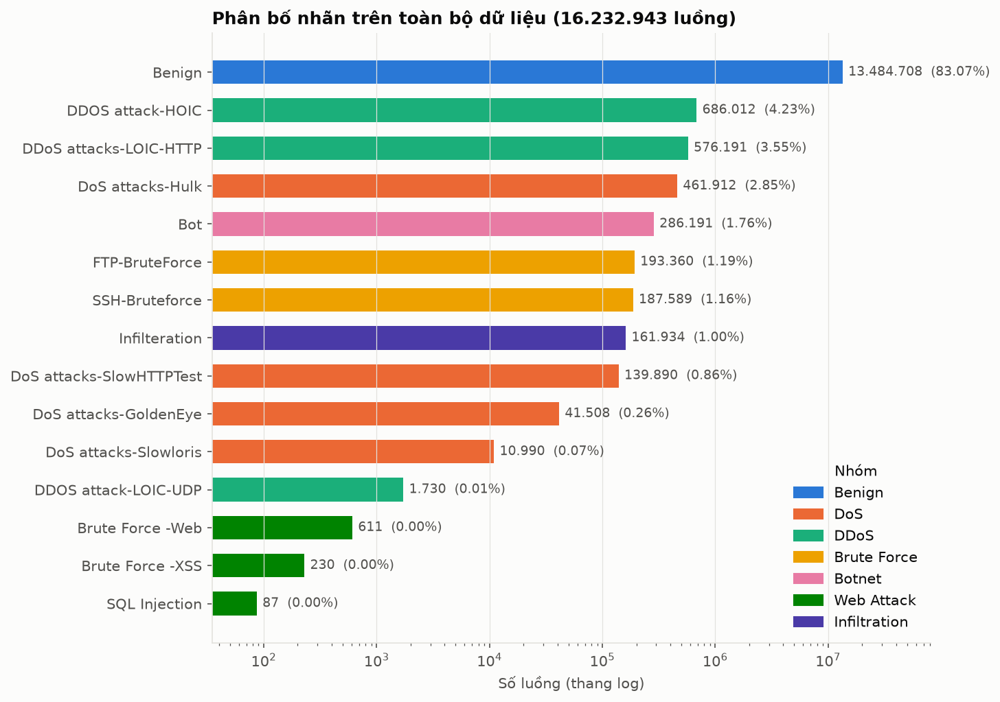
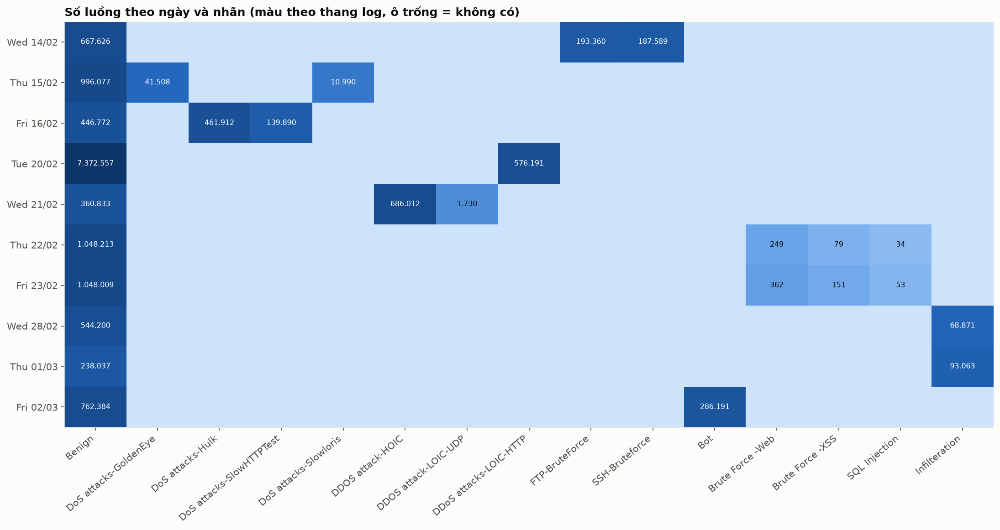
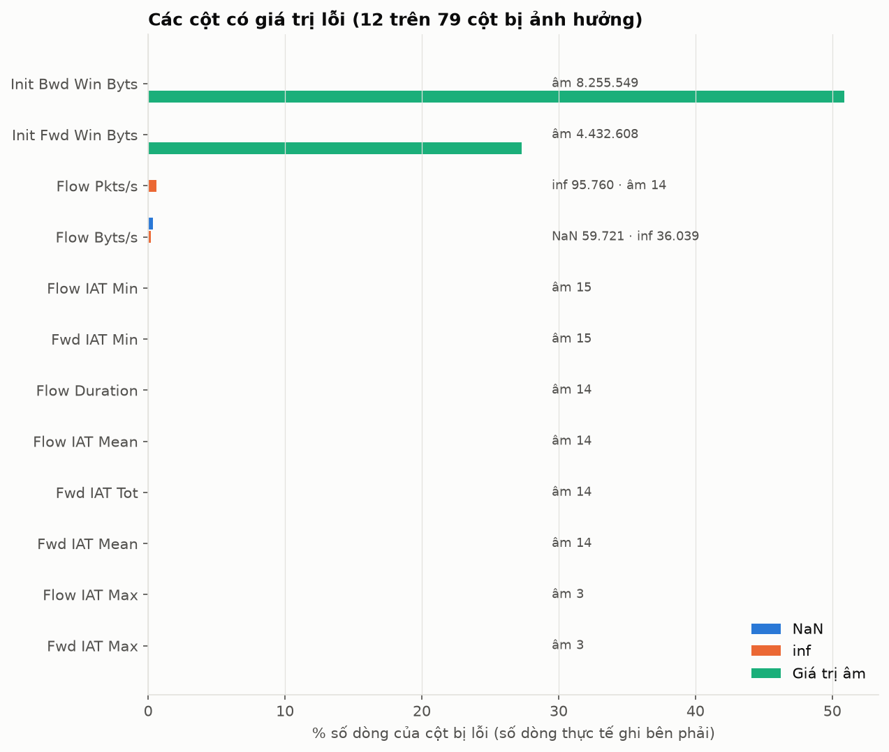
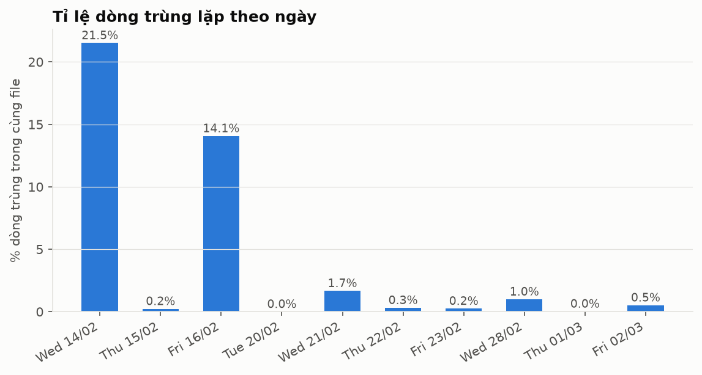
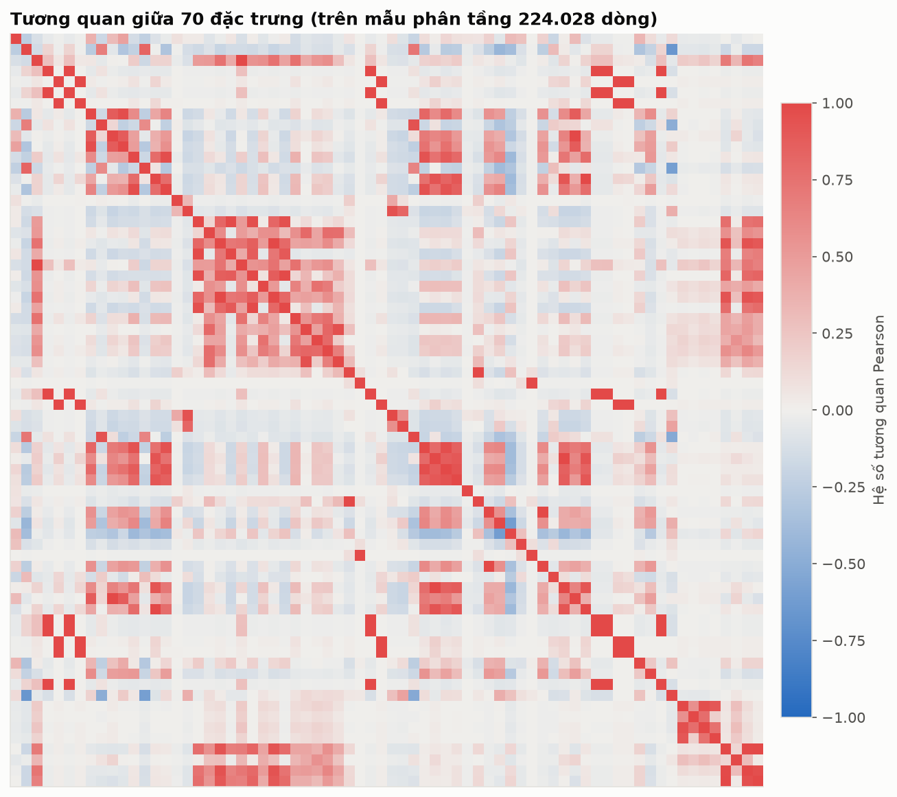
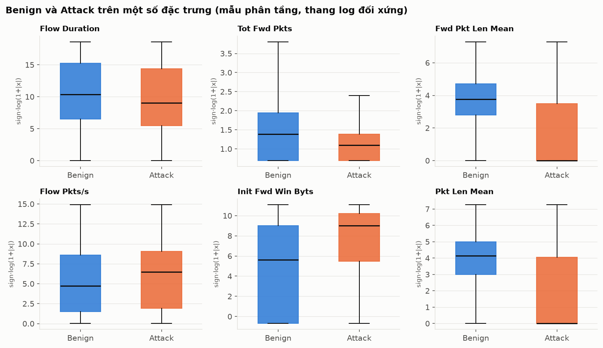
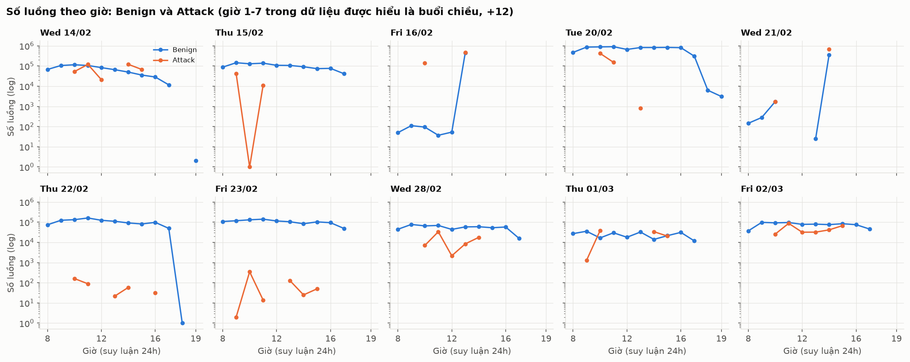
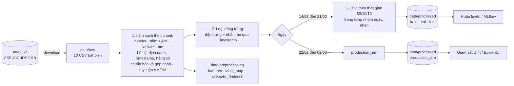
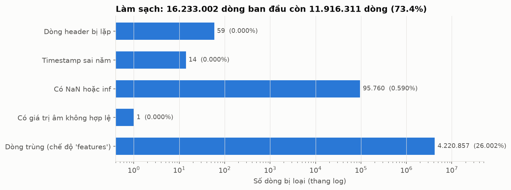
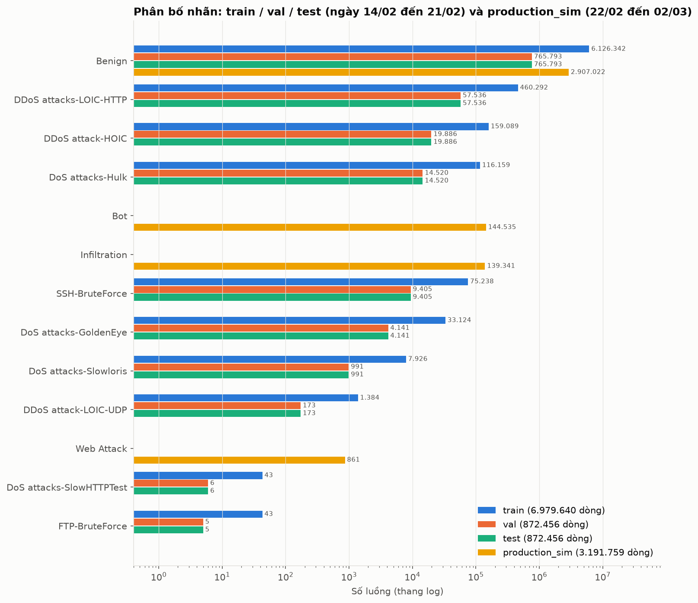

# Data – Báo cáo phân tích và quản lý dữ liệu cho CyberMLOps

> Báo cáo này mô tả **phần Dữ liệu** (Giai đoạn 1) của dự án: nguồn dữ liệu, kết quả phân tích khám phá (EDA) trên **dữ liệu thật**, các quyết định xử lý rút ra từ EDA, và cách chia tập.
> Mọi con số bên dưới được tạo bởi code trong `src/data/` và lưu ở `reports/data/` (có thể chạy lại, xem [mục 8](#8-cách-chạy-lại)).

> **Trạng thái (cập nhật 28/10/2026):** EDA đã hoàn thành. **Tiền xử lý, xuất Parquet và chia train/val/test 80/10/10 đã được cài đặt và chạy trên toàn bộ dữ liệu**, theo các quyết định nhóm đã chốt trong `QUYET_DINH.md` (mục 3 đến 5 bên dưới).

## Lịch sử thay đổi

**28/10/2026** – bổ sung tiền xử lý, xuất Parquet, chia 80/10/10. Các mục đã thay đổi trong file này (đánh dấu *"(cập nhật 28/10)"* ở tiêu đề):

| Mục | Thay đổi |
|---|---|
| Đầu file | Cập nhật dòng "Trạng thái"; thêm bảng lịch sử thay đổi này |
| 2.5 Trùng lặp | **Thêm** đoạn bổ sung: loại trùng theo đặc trưng cho kết quả rất khác (FTP-BruteForce chỉ còn 53 vector) |
| 3 Quyết định xử lý | **Viết lại** theo kết luận của nhóm, kèm cột "Trạng thái trong code" |
| 4 Pipeline | **Thay sơ đồ** bằng quy trình thật (`preprocess.py`); **thêm mục 4.1** kết quả chạy tiền xử lý |
| 5 Chia tập | **Viết lại**: chia theo giai đoạn (#2) và theo thời gian trong từng nhóm (ngày, nhãn) (#3, #4) đã cài đặt |
| 6 Version hóa | Cập nhật dòng "Tham số" và "Dữ liệu xử lý" |
| 7 Cấu trúc thư mục | **Cập nhật**: thêm `params.yaml`, `data/preprocessing/`, `data/processed/`, `tests/data/` |
| 8 Cách chạy lại | **Thêm** lệnh tiền xử lý, vẽ biểu đồ, chạy test; bản `.ipynb` và `.html` nằm trong `notebooks/` |
| 9 Rủi ro | **Thêm** các rủi ro mới (lớp quá nhỏ sau loại trùng, nhiễu nhãn, cột `meta_*`) |
| 10 Checklist | Tích các mục đã làm |
| 11 Data Card | **Thêm** các dòng về dữ liệu sau tiền xử lý và cách chia |
| Các mục 1, 2.1 đến 2.4, 2.6 đến 2.8 | Không đổi |

**File mới:** `params.yaml`, `src/data/preprocess.py`, `src/data/plot_preprocess.py`, `tests/data/test_processed.py`, `data/preprocessing/*.json`, `data/processed/*.parquet`, `reports/data/cleaning_report.json`, `reports/data/split_report.json`, `reports/data/figures/08_*.png`, `09_*.png`, `10_*.png`. **Cũng đã cập nhật:** `notebooks/HUONG_DAN_DATA.md` (bước 5 đến 13) và `notebooks/QUYET_DINH.md` (thêm bảng "code đã làm theo kết luận thế nào").

---

## Mục lục

0. [Lịch sử thay đổi](#lịch-sử-thay-đổi)
1. [Nguồn dữ liệu](#1-nguồn-dữ-liệu)
2. [Kết quả EDA](#2-kết-quả-eda)
3. [Quyết định xử lý](#3-quyết-định-xử-lý-cập-nhật-2810)
4. [Pipeline dữ liệu](#4-pipeline-dữ-liệu-cập-nhật-2810) (có mục 4.1 kết quả tiền xử lý)
5. [Chia tập](#5-chia-tập-viết-lại-2810)
6. [Version hóa và tái lập](#6-version-hóa-và-tái-lập-cập-nhật-2810)
7. [Cấu trúc thư mục và đầu ra](#7-cấu-trúc-thư-mục-và-đầu-ra-cập-nhật-2810)
8. [Cách chạy lại](#8-cách-chạy-lại-cập-nhật-2810)
9. [Rủi ro và lưu ý](#9-rủi-ro-và-lưu-ý-cập-nhật-2810)
10. [Checklist](#10-checklist-cập-nhật-2810)
11. [Data Card](#11-data-card-cập-nhật-2810)

---

## 1. Nguồn dữ liệu

| Hạng mục | Nội dung |
|---|---|
| Bộ dữ liệu | CSE-CIC-IDS2018 (CSE và Canadian Institute for Cybersecurity) |
| Nguồn tải | AWS Open Data, bucket công khai `s3://cse-cic-ids2018/Processed Traffic Data for ML Algorithms/` (không cần tài khoản). Trang: <https://registry.opendata.aws/cse-cic-ids2018/> |
| Trang gốc | <https://www.unb.ca/cic/datasets/ids-2018.html> |
| Định dạng | 10 file CSV (mỗi file một ngày), đặc trưng mức luồng mạng trích bằng CICFlowMeter |
| Dung lượng | 6,4 GiB (4,05 GB riêng file ngày 20/02) |
| Kiểm tra toàn vẹn | Dung lượng 10 file khớp từng byte với nguồn; checksum SHA-256 trong `data/raw/MANIFEST.json` |

**Lưu ý về bản Kaggle:** bản Kaggle `primus11/cic-ids-2018-dataset` chỉ có một file (ngày 14/02) nên không dùng; chi tiết ở `HUONG_DAN_DATA.md`.

> `data/raw/cic.csv` là bản tải cũ từ Kaggle, **giống hệt** `Wednesday-14-02-2018...csv` (cùng SHA-256). Pipeline chỉ đọc các file `*_TrafficForML_CICFlowMeter.csv` nên không bị đếm trùng.

---

## 2. Kết quả EDA

Phạm vi: **16.232.943 luồng**, **15 nhãn**, 10 ngày (14/02 đến 02/03/2018). Mỗi dòng là một luồng mạng; có 79 đặc trưng số và nhãn `Label`.

### 2.1. Quy mô theo ngày

| Ngày | Số dòng | Dòng trùng | Header lặp | Dòng lệch ngày |
|---|---:|---:|---:|---:|
| Wed 14/02 | 1.048.575 | 225.628 (21,5%) | 0 | 5 |
| Thu 15/02 | 1.048.575 | 2.421 (0,2%) | 0 | 0 |
| Fri 16/02 | 1.048.574 | 147.539 (14,1%) | 1 | 0 |
| Tue 20/02 | **7.948.748** | 2 (0,0%) | 0 | 0 |
| Wed 21/02 | 1.048.575 | 17.557 (1,7%) | 0 | 0 |
| Thu 22/02 | 1.048.575 | 3.278 (0,3%) | 0 | 9 |
| Fri 23/02 | 1.048.575 | 2.614 (0,2%) | 0 | 0 |
| Wed 28/02 | 613.071 | 6.089 (1,0%) | 33 | 0 |
| Thu 01/03 | 331.100 | 73 (0,0%) | 25 | 0 |
| Fri 02/03 | 1.048.575 | 5.459 (0,5%) | 0 | 0 |
| **Tổng** | **16.232.943** | **410.660 (2,5%)** | **59** | **14** |

Nhận xét:
- Ngày 20/02 chiếm gần một nửa dữ liệu (49%). Các file còn lại đều dừng ở đúng 1.048.575 dòng (giới hạn số dòng của Excel trừ một), cho thấy chúng có thể đã từng bị cắt bởi phần mềm bảng tính, nên có thể thiếu luồng ở cuối mỗi ngày. Đây là suy luận từ con số, chưa kiểm chứng với nguồn.
- Dòng "trùng" ở bảng này là trùng nguyên dòng **trong cùng một file** (tính bằng băm theo chunk). Với hai file có trùng nhiều nhất, kiểm tra trực tiếp bằng pandas cho 225.628 (14/02) và 147.586 (16/02), chênh 47 dòng so với bảng ở file 16/02.

### 2.2. Phân bố nhãn



| Nhãn | Số luồng | Tỉ lệ |
|---|---:|---:|
| Benign | 13.484.708 | 83,07% |
| DDOS attack-HOIC | 686.012 | 4,23% |
| DDoS attacks-LOIC-HTTP | 576.191 | 3,55% |
| DoS attacks-Hulk | 461.912 | 2,85% |
| Bot | 286.191 | 1,76% |
| FTP-BruteForce | 193.360 | 1,19% |
| SSH-Bruteforce | 187.589 | 1,16% |
| Infilteration *(viết sai chính tả trong dữ liệu gốc)* | 161.934 | 1,00% |
| DoS attacks-SlowHTTPTest | 139.890 | 0,86% |
| DoS attacks-GoldenEye | 41.508 | 0,26% |
| DoS attacks-Slowloris | 10.990 | 0,07% |
| DDOS attack-LOIC-UDP | 1.730 | 0,01% |
| Brute Force -Web | 611 | 0,004% |
| Brute Force -XSS | 230 | 0,001% |
| SQL Injection | 87 | 0,0005% |

**Rút ra:**
- Tổng lưu lượng tấn công là 2.748.235 luồng (16,93%). Bài toán nhị phân mất cân bằng vừa phải (khoảng 5:1), nhưng bài toán đa lớp **mất cân bằng cực lớn**: lớp nhỏ nhất (SQL Injection) chỉ có 87 mẫu, kém Benign hơn 150.000 lần.
- Không dùng Accuracy. Dùng Recall, F1, PR-AUC và FPR (đúng như README).
- Với đa lớp, ba lớp Web (611, 230, 87 mẫu) quá ít để huấn luyện ổn định; cần gộp thành một lớp "Web Attack" hoặc loại khỏi giai đoạn đa lớp.
- Tên nhãn không nhất quán (`DDOS` và `DDoS`, `Infilteration`) cần chuẩn hóa khi lập `label_map`.

### 2.3. Nhãn theo ngày



Mỗi ngày chỉ có một vài loại tấn công, và **không loại tấn công nào xuất hiện ở hai nhóm ngày khác nhau** (trừ Web ở 22/02 và 23/02, Infiltration ở 28/02 và 01/03):

| Ngày | Tấn công |
|---|---|
| 14/02 | FTP-BruteForce, SSH-Bruteforce |
| 15/02 | DoS GoldenEye, DoS Slowloris |
| 16/02 | DoS Hulk, DoS SlowHTTPTest |
| 20/02 | DDoS LOIC-HTTP |
| 21/02 | DDoS HOIC, DDoS LOIC-UDP |
| 22/02, 23/02 | Brute Force Web, Brute Force XSS, SQL Injection |
| 28/02, 01/03 | Infiltration |
| 02/03 | Bot |

**Rút ra:** chia theo ngày đồng nghĩa với việc mô hình phải nhận diện loại tấn công **chưa từng thấy**. Điều này vừa là rủi ro vừa là cơ hội cho kịch bản Drift (xem mục 5).

### 2.4. Giá trị lỗi



| Vấn đề | Số liệu | Cột |
|---|---|---|
| `inf` | 131.799 giá trị | `Flow Pkts/s` (95.760), `Flow Byts/s` (36.039) |
| `NaN` | 59.721 giá trị | chỉ `Flow Byts/s` |
| Giá trị âm ở cột bắt buộc không âm | 14 dòng | `Flow Duration`, `Flow IAT *`, `Fwd IAT *`, `Flow Pkts/s` (giá trị rất âm, cỡ −9×10¹¹) |
| Giá trị −1 ở cột cửa sổ TCP | 4.432.608 (27,3%) và 8.255.549 (50,9%) | `Init Fwd Win Byts`, `Init Bwd Win Byts` |
| Cột hằng số (phương sai 0) | 8 cột | `Bwd PSH Flags`, `Bwd URG Flags`, `Fwd Byts/b Avg`, `Fwd Pkts/b Avg`, `Fwd Blk Rate Avg`, `Bwd Byts/b Avg`, `Bwd Pkts/b Avg`, `Bwd Blk Rate Avg` |
| Dòng header lặp trong dữ liệu | 59 dòng | file 16/02 (1), 28/02 (33), 01/03 (25) |
| Dòng `Timestamp` sai năm (1970) | 14 dòng, **đều là Benign** | 14/02 (5), 22/02 (9) |
| Cột chỉ có ở một file | 4 cột `Flow ID`, `Src IP`, `Src Port`, `Dst IP` | chỉ file 20/02 |

**Rút ra:**
- Lỗi `inf`/`NaN` rất ít (tối đa 191.520 giá trị, dưới 1,2% số dòng) nên xóa dòng là chấp nhận được.
- Giá trị −1 ở `Init Fwd/Bwd Win Byts` **chiếm tới 27% và 51%** số dòng. Đây rất có thể là giá trị "không có cửa sổ" do CICFlowMeter gán chứ không phải lỗi; **không được xóa** các dòng này. Nên giữ nguyên hoặc thêm cột cờ.
- 14 dòng có thời lượng âm cực lớn là lỗi thật và nên loại.
- Bốn cột chỉ có ở file 20/02 là định danh (IP, cổng, Flow ID), vốn phải bỏ để tránh rò rỉ, nên sự khác biệt này không gây hại sau khi bỏ.

### 2.5. Trùng lặp



Trùng lặp tập trung ở hai ngày (14/02 và 16/02, chiếm 91% tổng số dòng trùng). Kiểm tra theo nhãn:

| File | Dòng trùng | Phân bổ theo nhãn |
|---|---:|---|
| 14/02 | 225.628 | FTP-BruteForce 154.008 (80% lớp này), SSH-Bruteforce 70.267 (37%), Benign 1.353 |
| 16/02 | 147.586 | SlowHTTPTest 120.428 (86% lớp này), Hulk 27.039 (6%), Benign 119 |

Nếu bỏ qua cột `Timestamp` khi so sánh, số dòng trùng tăng lên 373.760 (14/02) và 456.673 (16/02).

**Rút ra:** các dòng trùng **chủ yếu là luồng tấn công** (công cụ tấn công gửi lặp đi lặp lại cùng một mẫu gói tin), không phải rác. Có hai hệ quả:
1. Nếu không loại trùng trước khi chia tập, cùng một mẫu sẽ rơi vào cả train và test, khiến kết quả đẹp giả (rò rỉ).
2. Nếu loại trùng, các lớp FTP-BruteForce và SlowHTTPTest **mất 80% đến 86% số mẫu**.

Đây là quyết định cần cân nhắc (xem mục 3).

**Bổ sung sau khi chạy tiền xử lý (cập nhật 28/10):** các con số trên so sánh nguyên dòng, tức gồm cả `Timestamp`. Nếu chỉ so sánh **đặc trưng và nhãn** (bỏ qua thời điểm, đúng như quyết định #1 của nhóm), kết quả rất khác: trên toàn bộ dữ liệu đã làm sạch có **4.220.857 dòng trùng (26,2%)**, và hai lớp bị ảnh hưởng nặng nhất chỉ có rất ít vector đặc trưng khác nhau:

| Lớp | Số dòng (sau làm sạch) | Số vector đặc trưng khác nhau |
|---|---:|---:|
| FTP-BruteForce | 193.354 | **53** |
| DoS attacks-SlowHTTPTest | 139.890 | **55** |

Tức là hàng trăm nghìn luồng của hai lớp này thực chất là cùng một vài mẫu lặp lại ở các thời điểm khác nhau. Hệ quả cho cách chia tập xem mục 4.1 và 5.

### 2.6. Tương quan giữa các đặc trưng



Trên mẫu phân tầng 224.028 dòng, 70 đặc trưng có biến thiên, có **34 cặp** với |r| ≥ 0,99. Ví dụ các cặp gần như giống hệt nhau:

| Cặp | r |
|---|---:|
| `Fwd Pkt Len Mean` và `Fwd Seg Size Avg` | 1,00 |
| `Bwd Pkt Len Mean` và `Bwd Seg Size Avg` | 1,00 |
| `Tot Fwd Pkts` và `Subflow Fwd Pkts` | 1,00 |
| `Tot Bwd Pkts` và `Subflow Bwd Pkts` | 1,00 |
| `TotLen Fwd Pkts` và `Subflow Fwd Byts` | 1,00 |
| `RST Flag Cnt` và `ECE Flag Cnt` | 1,00 |

**Rút ra:** có thể bỏ bớt đặc trưng thừa (giữ một đặc trưng đại diện mỗi nhóm) mà không mất thông tin; giúp mô hình nhẹ hơn và Logistic Regression ổn định hơn. Mẫu dùng ở đây là mẫu phân tầng (không tỉ lệ thật), nên hệ số tương quan chỉ mang tính tham khảo.

### 2.7. Benign so với Attack



Trên các đặc trưng được chọn, phân phối của Benign và Attack **chồng lấn lớn** (ví dụ `Flow Duration`, `Flow Pkts/s`), nhưng khác biệt rõ ở một số đặc trưng như `Fwd Pkt Len Mean` và `Pkt Len Mean` (Attack có trung vị gần 0, tức nhiều gói không mang dữ liệu), hoặc `Init Fwd Win Byts` (Attack cao hơn). Không đặc trưng đơn lẻ nào đủ để phân tách, nên cần mô hình kết hợp nhiều đặc trưng (đúng lý do chọn XGBoost). Biểu đồ dùng mẫu phân tầng, không phản ánh tỉ lệ thật.

### 2.8. Thời gian



Phát hiện quan trọng cho việc chia theo thời gian:
- Ở **cả 10 ngày chỉ có giờ từ 1 đến 12**, không có giờ 0 hay 13 đến 23. Đây là dấu hiệu của **đồng hồ 12 giờ mất AM/PM**.
- Giờ 6 và 7 hầu như vắng mặt, còn giờ 8 đến 12 và 1 đến 5 có nhiều dữ liệu, khớp với giờ làm việc 8h đến 17h nếu hiểu giờ 1 đến 5 là buổi chiều (13h đến 17h). Do đó biểu đồ trên **suy luận** giờ 1 đến 7 là buổi chiều (cộng 12). Đây là giả định, chưa được tài liệu gốc xác nhận.
- **Không file nào được sắp theo thứ tự thời gian.** Không thể chia theo "đầu ngày, cuối ngày" chỉ bằng thứ tự dòng.
- Ở hai ngày 16/02 và 21/02, dữ liệu dồn vào rất ít giờ: ngày 16/02 có 86,6% luồng ở giờ 1 và 13,3% ở giờ 10; ngày 21/02 có 99,6% luồng ở giờ 2 (giá trị giờ gốc trong dữ liệu). Chia theo giờ không có ý nghĩa với hai ngày này.
- Tấn công thường xảy ra trong khoảng 9h đến 16h (suy luận).

---

## 3. Quyết định xử lý *(cập nhật 28/10)*

Cột **Kết luận của nhóm** lấy từ `QUYET_DINH.md` (số trong ngoặc là số điểm trong file đó). Cột **Trạng thái trong code** cho biết `src/data/preprocess.py` đã làm chưa; mọi lựa chọn đổi được trong `params.yaml`.

| # | Vấn đề | Kết luận của nhóm | Trạng thái trong code |
|---|---|---|---|
| 1 | Header lặp (59 dòng) | Loại | **Đã làm**: loại 59 dòng |
| 2 | `Timestamp` sai năm (14 dòng Benign) | Loại | **Đã làm**: loại 14 dòng |
| 3 | `inf`/`NaN` ở `Flow Byts/s`, `Flow Pkts/s` | Loại dòng (#5) | **Đã làm**: loại 95.760 dòng (0,59%) |
| 4 | Thời lượng/IAT âm | Loại | **Đã làm**: loại 1 dòng. Nhiều khả năng 14 dòng âm còn lại trùng với 14 dòng `Timestamp` sai năm đã loại trước đó (số lượng khớp, chưa kiểm chứng trực tiếp) |
| 5 | `Init Fwd/Bwd Win Byts = -1` | **Giữ nguyên**, không xóa dòng, thêm hai cột cờ `fwd_win_missing`, `bwd_win_missing` (#6) | **Đã làm**: giữ −1; thêm 2 cột cờ (train: 20,0% và 36,7% số dòng có cờ bằng 1) |
| 6 | 8 cột hằng số | Bỏ (#11) | **Đã làm** |
| 7 | Cột định danh (`Flow ID`, `Src IP`, `Dst IP`, `Src Port`) và `Timestamp` | Không làm đặc trưng; `Timestamp` chỉ dùng để sắp thứ tự khi chia (#3, #4) | **Đã làm** |
| 8 | Đặc trưng tương quan ≥ 0,99 (34 cặp) | **Ngưỡng chưa chốt** (#11) | **Chưa bỏ**: có sẵn tùy chọn `features.drop_correlated`, mặc định tắt. Dữ liệu xuất ra giữ đủ 70 đặc trưng gốc |
| 9 | Dòng trùng | Loại trước khi chia, **so trên các cột đặc trưng, bỏ qua `Timestamp`** (#1) | **Đã làm** (chế độ `features`): loại 4.220.857 dòng (26,2%). **FTP-BruteForce còn 53 dòng, SlowHTTPTest còn 55 dòng** (xem 4.1) |
| 10 | Tên nhãn không nhất quán | Chuẩn hóa (#10) | **Đã làm**: 4 nhãn đổi tên, có `label_map.json` |
| 11 | Lớp Web quá ít (611, 230, 87) | Gộp thành "Web Attack" (#9) | **Đã làm**: `Label` đã gộp, nhãn gốc giữ ở `Label_raw` |
| 12 | Mất cân bằng lớp | Trọng số lớp, không SMOTE (#13) | Thuộc bước huấn luyện. `scale_pos_weight` = Benign/Attack trên train ≈ 7,18 |
| 13 | Ngày 20/02 chiếm 49% dữ liệu, 93% là Benign | Lấy mẫu Benign, **tỉ lệ chưa chốt** (#7) | **Chưa làm**: giữ toàn bộ (còn 5.493.517 Benign của ngày 20/02 sau loại trùng) |
| 14 | `Dst Port`, `Protocol` có làm đặc trưng không | TV2 thử cả hai, so sánh trên MLflow (#12) | **Đang giữ** cả hai cột |
| 15 | Scaler | `RobustScaler` chỉ cho SVM, đặt trong `Pipeline` của mô hình (#14) | Thuộc bước huấn luyện, **không** làm trong pipeline dữ liệu |
| 16 | Chia tập | Theo giai đoạn (#2), theo thời gian trong từng nhóm (ngày, nhãn) (#3), giả định AM/PM (#4) | **Đã làm** (mục 5) |

> **Lưu ý về quyết định #1.** Khi quyết định này được chốt, dữ liệu so sánh được nêu là "loại trùng, FTP-BruteForce còn khoảng 39 nghìn mẫu" (con số đó là khi so trùng **cả thời điểm**). Khi chạy đúng như quyết định (bỏ qua `Timestamp`), FTP-BruteForce và SlowHTTPTest chỉ còn **53 và 55 dòng**, và sau khi chia chỉ có 5 đến 6 mẫu ở val và test. Nhóm nên xem lại điểm này. Cách đổi: `clean.dedup: exact` trong `params.yaml` (loại 431.731 dòng trùng thật; FTP còn 39.346 và SlowHTTPTest còn 19.462), rồi chạy lại `python src/data/preprocess.py` (khoảng 5 phút).

---

## 4. Pipeline dữ liệu *(cập nhật 28/10)*



Toàn bộ các bước nằm trong một script `src/data/preprocess.py`, đọc tham số từ `params.yaml`, đọc dữ liệu theo từng chunk nên chạy được với file 4 GB. Toàn bộ dữ liệu mất khoảng 5 phút. Phần chưa làm: kiểm tra schema dữ liệu thô trước khi làm sạch (`validate.py`); scaler và trọng số lớp (thuộc bước huấn luyện, #13 và #14).

### 4.1. Kết quả chạy tiền xử lý *(mục mới, 28/10)*



| Bước | Số dòng loại | Còn lại |
|---|---:|---:|
| Dữ liệu ban đầu (10 file) | | 16.233.002 |
| Dòng header bị lặp | 59 | |
| `Timestamp` sai năm | 14 | |
| Có `NaN` hoặc `inf` | 95.760 | |
| Có giá trị âm không hợp lệ | 1 | 16.137.168 |
| Dòng trùng (đặc trưng + nhãn) | 4.220.857 | **11.916.311** (73,4%) |

**Cột:** từ 80 cột chung (78 đặc trưng, `Timestamp`, `Label`) còn **70 đặc trưng gốc** sau khi bỏ 8 cột hằng số, cộng **2 cột cờ** (`fwd_win_missing`, `bwd_win_missing`) thành **72 đặc trưng**. Danh sách ở `data/preprocessing/features.json`.

**Số dòng theo nhãn (nhãn đã chuẩn hóa và gộp):**

| Nhãn | Sau làm sạch | Sau loại trùng | Giữ lại |
|---|---:|---:|---:|
| Benign | 13.390.234 | 10.564.950 | 78,9% |
| DDoS attack-HOIC | 686.012 | 198.861 | 29,0% |
| DDoS attacks-LOIC-HTTP | 576.191 | 575.364 | 99,9% |
| DoS attacks-Hulk | 461.912 | 145.199 | 31,4% |
| Bot | 286.191 | 144.535 | 50,5% |
| FTP-BruteForce | 193.354 | 53 | 0,03% |
| SSH-BruteForce | 187.589 | 94.048 | 50,1% |
| Infiltration | 160.639 | 139.341 | 86,7% |
| DoS attacks-SlowHTTPTest | 139.890 | 55 | 0,04% |
| DoS attacks-GoldenEye | 41.508 | 41.406 | 99,8% |
| DoS attacks-Slowloris | 10.990 | 9.908 | 90,2% |
| DDoS attack-LOIC-UDP | 1.730 | 1.730 | 100,0% |
| Web Attack | 928 | 861 | 92,8% |

Hai lớp **FTP-BruteForce** và **DoS attacks-SlowHTTPTest** chỉ giữ lại 0,03% và 0,04% số dòng, vì chúng gồm các luồng gần như giống hệt nhau (chỉ khác thời điểm). Các lớp DDoS HOIC, DoS Hulk, Bot, SSH-BruteForce cũng mất từ 50% đến 71%. Benign mất 21,1%.

**Nhiễu nhãn:** có **21.748 vector đặc trưng** xuất hiện với nhiều hơn một nhãn, ảnh hưởng **43.501 dòng** (0,37% sau loại trùng). Chưa xử lý các dòng này.

**Định dạng đầu ra** (`data/processed/*.parquet`, nén zstd): 72 cột đặc trưng (`float32`; hai cột cờ kiểu `int8`), cộng:

| Cột | Ý nghĩa |
|---|---|
| `Label` | Nhãn chuẩn hóa và đã gộp lớp Web (13 giá trị) |
| `Label_raw` | Nhãn chuẩn hóa nhưng chưa gộp (15 giá trị) |
| `y_binary` | 0 = Benign, 1 = Attack |
| `y_multi` | Mã nhãn 0 đến 12 theo `data/preprocessing/label_map.json` |
| `meta_day` | Ngày thu thập (dạng `2018-02-14`). **Không đưa vào mô hình** |
| `meta_time` | Thời điểm đã suy luận AM/PM (giả định #4). **Không đưa vào mô hình** |
| `meta_key` | Khóa băm đặc trưng + nhãn, dùng kiểm tra rò rỉ giữa các tập. **Không đưa vào mô hình** |

Các dòng trong mỗi file chưa được xáo trộn; cần xáo trộn khi huấn luyện.

---

## 5. Chia tập *(viết lại 28/10)*

### 5.1. Cách chia (theo #2, #3, #4)

1. **Theo giai đoạn (#2):** các ngày **14/02 đến 21/02** dùng để chia train/val/test; các ngày **22/02 đến 02/03** là `production_sim`, không chia, để mô phỏng dữ liệu vận hành và Drift. Ba nhóm tấn công mới (Web, Infiltration, Bot) chỉ có ở giai đoạn sau, nên mô hình ban đầu chưa từng thấy chúng.
2. **Sắp thứ tự theo thời gian (#4):** `Timestamp` chỉ có giờ 1 đến 12 (mất AM/PM), nên giờ 1 đến 7 được hiểu là buổi chiều (cộng 12). **Đây là giả định**, chưa được tài liệu gốc xác nhận. Các dòng cùng `Timestamp` giữ thứ tự gốc.
3. **Trong từng nhóm (ngày, nhãn) (#3):** 80% dòng sớm nhất là train, 10% kế là val, 10% muộn nhất là test. Không cắt theo thời gian trên cả ngày, vì tấn công chỉ kéo dài vài giờ nên val/test sẽ thiếu hầu hết loại tấn công (`QUYET_DINH.md`, Phụ lục 2).

Loại dòng trùng làm **trước** khi chia (#1), nên không còn dòng nào xuất hiện ở hai tập.



| Tập | Số dòng | Tỉ lệ Attack | Khoảng thời gian | File |
|---|---:|---:|---|---:|
| train | 6.979.640 | 12,2% | 2018-02-14 đến 2018-02-21 | 755 MB |
| val | 872.456 | 12,2% | 2018-02-14 đến 2018-02-21 | 98 MB |
| test | 872.456 | 12,2% | 2018-02-14 đến 2018-02-21 | 99 MB |
| production_sim | 3.191.759 | 8,9% | 2018-02-22 đến 2018-03-02 | 350 MB |

Train, val và test là 80%, 10% và 10% của **8.724.552 dòng** thuộc giai đoạn 14/02 đến 21/02 (không phải của toàn bộ 11.916.311 dòng). `production_sim` (3.191.759 dòng) thêm vào theo từng ngày:

| Ngày | Số dòng trong `production_sim` |
|---|---:|
| 22/02 | 831.991 |
| 23/02 | 821.272 |
| 28/02 | 474.419 |
| 01/03 | 269.329 |
| 02/03 | 794.748 |

### 5.2. Chia trong từng nhóm (ngày, nhãn)


| Ngày | Nhãn | Số dòng | Train | Val | Test |
|---|---|---:|---:|---:|---:|
| 14/02 | Benign | 577.032 | 461.626 | 57.703 | 57.703 |
| 14/02 | FTP-BruteForce | 53 | 43 | 5 | 5 |
| 14/02 | SSH-BruteForce | 94.048 | 75.238 | 9.405 | 9.405 |
| 15/02 | Benign | 779.930 | 623.944 | 77.993 | 77.993 |
| 15/02 | DoS attacks-GoldenEye | 41.406 | 33.124 | 4.141 | 4.141 |
| 15/02 | DoS attacks-Slowloris | 9.908 | 7.926 | 991 | 991 |
| 16/02 | Benign | 446.647 | 357.317 | 44.665 | 44.665 |
| 16/02 | DoS attacks-Hulk | 145.199 | 116.159 | 14.520 | 14.520 |
| 16/02 | DoS attacks-SlowHTTPTest | 55 | 43 | 6 | 6 |
| 20/02 | Benign | 5.493.517 | 4.394.813 | 549.352 | 549.352 |
| 20/02 | DDoS attacks-LOIC-HTTP | 575.364 | 460.292 | 57.536 | 57.536 |
| 21/02 | Benign | 360.802 | 288.642 | 36.080 | 36.080 |
| 21/02 | DDoS attack-HOIC | 198.861 | 159.089 | 19.886 | 19.886 |
| 21/02 | DDoS attack-LOIC-UDP | 1.730 | 1.384 | 173 | 173 |

### 5.3. Lưu ý khi đọc kết quả mô hình

1. **Hai lớp quá nhỏ.** FTP-BruteForce (53 dòng) chia ra 43 / 5 / 5; DoS attacks-SlowHTTPTest (55 dòng) chia ra 43 / 6 / 6. Chỉ số của hai lớp này trên val/test dựa trên 5 đến 6 mẫu nên **gần như không có ý nghĩa thống kê**. Đây là hệ quả của quyết định #1 (xem mục 3).
2. **Giả định AM/PM** ảnh hưởng đến việc dòng nào thuộc train, val hay test. Nếu giả định sai, thứ tự thời gian trong mỗi nhóm có thể bị lệch.
3. **Nhiễu nhãn** (43.501 dòng) đặt giới hạn cho Precision và Recall.
4. **Val/test muộn hơn train trong từng nhóm**, nên có thể phản ánh một chút thay đổi theo thời gian trong cùng ngày; điều này là chủ đích của quyết định #3.
5. **`scale_pos_weight`** cho XGBoost (#13) tính trên train: Benign / Attack = 6.126.342 / 853.298 ≈ 7,18. Tính lại mỗi lần tái huấn luyện.

Mọi bước học tham số (scaler, trọng số lớp) chỉ `fit` trên tập train.

---

## 6. Version hóa và tái lập *(cập nhật 28/10)*

| Đối tượng | Cách quản lý |
|---|---|
| Mã xử lý | Git |
| Tham số | `params.yaml` (đã có): cột loại bỏ, chế độ loại trùng, giả định AM/PM, ngày chia, tỉ lệ chia, seed. Mỗi tham số ghi số quyết định của nhóm |
| Dữ liệu raw | Không commit; `data/raw/MANIFEST.json` (SHA-256 và dung lượng từng file) |
| Dữ liệu xử lý | `data/processed/*.parquet` (tổng khoảng 1,3 GB), **bị `.gitignore` chặn nên không lên Git**; tái tạo bằng `python src/data/preprocess.py` (cùng `seed` và cùng `params.yaml` cho kết quả giống nhau). `data/preprocessing/*.json` và `reports/data/*.json` nhỏ, có thể commit |
| Phiên bản dữ liệu (tùy chọn) | DVC (ngoài danh sách công cụ của README); nếu không dùng, tối thiểu log hash và `params.yaml` vào MLflow |

---

## 7. Cấu trúc thư mục và đầu ra *(cập nhật 28/10)*

```text
CIC-IDS-MLOps/
├── params.yaml                   # tham số pipeline dữ liệu
├── data/
│   ├── raw/                      # 10 CSV + MANIFEST.json (không commit)
│   ├── interim/                  # eda_sample.parquet, các phần trung gian (không commit)
│   ├── preprocessing/            # features.json, label_map.json, dropped_features.json
│   └── processed/                # train / val / test / production_sim (.parquet, không commit)
├── reports/data/
│   ├── eda_stats.json, eda_summary.json, timestamp_check.json   # kết quả EDA
│   ├── cleaning_report.json      # số dòng bị loại từng bước, từng nhãn; nhiễu nhãn
│   ├── split_report.json         # kích thước, nhãn, khoảng thời gian từng tập; chia từng nhóm
│   ├── preprocess.log
│   └── figures/                  # 01_ đến 07_ (EDA), 08_ đến 10_ (tiền xử lý)
├── src/data/
│   ├── download.py               # tạo MANIFEST.json
│   ├── eda_stats.py, eda_timestamps.py, eda_plots.py            # EDA
│   ├── preprocess.py             # làm sạch, loại trùng, chia, xuất Parquet
│   ├── plot_preprocess.py        # biểu đồ 08, 09, 10
│   ├── build_report_html.py      # notebooks/DATA.md -> notebooks/DATA_report.html
│   └── md_to_ipynb.py            # Markdown -> .ipynb trong notebooks/
├── tests/data/test_processed.py  # 9 test kiểm tra dữ liệu sau xử lý
├── notebooks/
│   ├── DATA.md                   # báo cáo này
│   ├── HUONG_DAN_DATA.md         # hướng dẫn từng bước để học
│   ├── QUYET_DINH.md             # các điểm nhóm cần thống nhất và kết luận
│   └── *.html, *.ipynb           # (tạo bằng hai script trên) bản HTML và notebook, ảnh nhúng sẵn
└── README.md                     # README gốc của dự án
```

Về mẫu `eda_sample.parquet`: lấy tối đa 4.000 dòng mỗi nhãn mỗi chunk 500.000 dòng, nên **không tỉ lệ thật**; chỉ dùng cho biểu đồ tương quan và boxplot. Các số đếm (nhãn, ngày, lỗi, trùng) lấy từ toàn bộ dữ liệu.

---

## 8. Cách chạy lại *(cập nhật 28/10)*

```bash
cd CIC-IDS-MLOps
source .venv/bin/activate                  # hoặc dùng đường dẫn tới python của venv

# 1. Tải dữ liệu (6,4 GiB). Dùng "python -m awscli" nếu đường dẫn có dấu/khoảng trắng
python -m awscli s3 sync --no-sign-request --region ca-central-1 \
  "s3://cse-cic-ids2018/Processed Traffic Data for ML Algorithms/" data/raw/

# 2. Checksum
python src/data/download.py

# 3. EDA (khoảng 5 phút, file 20/02 mất khoảng 2 phút)
python src/data/eda_stats.py
python src/data/eda_timestamps.py
python src/data/eda_plots.py

# 4. Tiền xử lý + chia + xuất Parquet (khoảng 5 phút; cần khoảng 3 GB đĩa tạm)
python src/data/preprocess.py              # thêm --smoke để chạy thử nhỏ (khoảng 20 giây)
python src/data/plot_preprocess.py         # biểu đồ 08, 09, 10
python -m pytest tests/data                # 9 test kiểm tra dữ liệu sau xử lý

# 5. Cập nhật bản HTML và notebook sau khi sửa file .md
python src/data/build_report_html.py
python src/data/md_to_ipynb.py notebooks/DATA.md notebooks/HUONG_DAN_DATA.md README.md
```

Nếu dữ liệu thô không nằm ở `data/raw/`, đặt biến môi trường `CIC_RAW_DIR` trỏ tới thư mục chứa 10 file CSV (hoặc sửa `data.raw_dir` trong `params.yaml`). Đổi cách xử lý (chế độ loại trùng, ngày chia, tỉ lệ chia, bỏ đặc trưng tương quan...) bằng cách sửa `params.yaml` rồi chạy lại bước 4.

---

## 9. Rủi ro và lưu ý *(cập nhật 28/10)*

| Rủi ro | Biện pháp |
|---|---|
| File có thể bị cắt ở 1.048.575 dòng | Đối chiếu với nguồn gốc/tài liệu CIC; ghi vào hạn chế của dữ liệu |
| Mất AM/PM nên giờ không đáng tin | Chỉ dùng giả định (#4) để sắp thứ tự khi chia; `Timestamp` không làm đặc trưng. Ghi rõ là giả định |
| **FTP-BruteForce và SlowHTTPTest chỉ còn 53 và 55 dòng sau loại trùng** *(mới)* | Nhóm xem lại #1; hoặc đổi `clean.dedup: exact`; hoặc không đánh giá riêng hai lớp này |
| **Nhiễu nhãn** (43.501 dòng có đặc trưng trùng nhưng nhãn khác) *(mới)* | Ghi nhận như giới hạn; có thể xem xét loại các dòng này khi huấn luyện |
| **Cột `meta_day`, `meta_time`, `meta_key` bị đưa nhầm vào mô hình** *(mới)* | Chỉ lấy cột trong `features.json`; test kiểm tra schema |
| **Dữ liệu xử lý không có trên Git** *(mới)* | Tái tạo bằng `preprocess.py` (cùng seed và `params.yaml` cho kết quả giống nhau) |
| Ngày 20/02 chiếm 49% dữ liệu | Lấy mẫu Benign (#7, chưa chốt tỉ lệ) |
| Xóa nhầm giá trị −1 hợp lệ | Giữ −1 và thêm cột cờ (đã áp dụng) |
| Hết RAM với file 4 GB | Đọc theo chunk; ghi Parquet `float32` (đã áp dụng) |
| Train–serve skew | Dùng chung `features.json`, `label_map.json` giữa huấn luyện và API; scaler nằm trong `Pipeline` của mô hình |
| Giấy phép | Kiểm tra điều khoản sử dụng của CIC trước khi chia sẻ lại dữ liệu |

---

## 10. Checklist *(cập nhật 28/10)*

- [x] Tải đủ 10 file, kiểm tra dung lượng và tạo `MANIFEST.json`
- [x] EDA: nhãn, theo ngày, giá trị lỗi, trùng lặp, tương quan, thời gian
- [x] Phát hiện vấn đề dữ liệu (AM/PM, trùng lặp, file bị cắt, giá trị −1)
- [x] Nhóm chốt các quyết định A và B trong `QUYET_DINH.md`
- [x] `params.yaml`
- [x] Làm sạch (NaN/inf, âm, header lặp, cột không cần thiết, tên nhãn, gộp lớp Web) và thêm cờ cho −1
- [x] Loại dòng trùng theo đặc trưng + nhãn (bỏ qua `Timestamp`) trước khi chia
- [x] Chia theo giai đoạn và theo thời gian 80/10/10 trong từng nhóm (ngày, nhãn)
- [x] Xuất Parquet (`data/processed/`) và `features.json`, `label_map.json` (`data/preprocessing/`)
- [x] Báo cáo `cleaning_report.json`, `split_report.json` và biểu đồ 08, 09, 10
- [x] Test cho dữ liệu sau xử lý (`tests/data/`, 9 test đều qua)
- [ ] Nhóm xem lại #1 (loại trùng làm FTP-BruteForce và SlowHTTPTest chỉ còn 53 và 55 dòng)
- [ ] Chốt các điểm còn mở: #7 (tỉ lệ lấy mẫu Benign 20/02), #11 (ngưỡng tương quan), phần C
- [ ] `validate.py`: kiểm tra schema dữ liệu thô trước khi làm sạch
- [ ] Scaler (SVM) và trọng số lớp: thuộc bước huấn luyện
- [ ] Tích hợp vào DAG Airflow (Giai đoạn 5)

---

## 11. Data Card *(cập nhật 28/10)*

| Hạng mục | Nội dung |
|---|---|
| Tên | CSE-CIC-IDS2018, thư mục "Processed Traffic Data for ML Algorithms" |
| Nguồn gốc | CSE và CIC (Canadian Institute for Cybersecurity); thu thập 14/02 đến 02/03/2018 trong môi trường doanh nghiệp mô phỏng |
| Giấy phép / điều khoản | Chưa kiểm tra; cần xem điều khoản trên trang CIC trước khi chia sẻ lại |
| Quy mô dữ liệu thô | 16.233.002 dòng (kể cả 59 dòng header lặp), 10 file, 6,4 GiB; 78 đặc trưng số, `Timestamp` và nhãn (80 cột chung) |
| Nhãn | 15 nhãn gốc: Benign (83,07%) và 14 loại tấn công (16,93%) |
| Phân bố theo ngày | Mỗi ngày chỉ có 1 đến 3 loại tấn công (mục 2.3) |
| Vấn đề chất lượng | Header lặp (59), `Timestamp` sai năm (14), `inf` (131.799 giá trị), `NaN` (59.721 giá trị), giá trị âm bất hợp lý, 8 cột hằng số, dòng trùng, tên nhãn không nhất quán |
| Vấn đề thời gian | Đồng hồ 12h mất AM/PM; file không sắp theo thời gian |
| Giới hạn đã biết | Dữ liệu mô phỏng, có thể khác lưu lượng thực; các file (trừ 20/02, 28/02, 01/03) có đúng 1.048.575 dòng, nghi bị cắt; mất cân bằng lớp nặng |
| Cột định danh | `Flow ID`, `Src IP`, `Dst IP`, `Src Port` chỉ có trong file 20/02; không dùng làm đặc trưng |
| **Dữ liệu sau tiền xử lý** *(mới)* | 11.916.311 dòng (73,4% dữ liệu thô), 72 đặc trưng (70 gốc + 2 cờ), 13 nhãn sau khi gộp lớp Web |
| **Cách chia** *(mới)* | 14/02 đến 21/02: train 6.979.640 / val 872.456 / test 872.456 (80/10/10, theo thời gian trong từng nhóm ngày, nhãn). 22/02 đến 02/03: `production_sim` 3.191.759 dòng. Tỉ lệ Attack: 12,2% ở train/val/test, 8,9% ở `production_sim` |
| **Giới hạn của dữ liệu đã xử lý** *(mới)* | FTP-BruteForce và SlowHTTPTest chỉ còn 53 và 55 dòng (5 đến 6 mẫu ở val và test); 43.501 dòng có nhãn mâu thuẫn; thứ tự thời gian dựa trên giả định AM/PM |
| Phiên bản dữ liệu | SHA-256 từng file thô trong `data/raw/MANIFEST.json`; dữ liệu xử lý tái tạo bằng `preprocess.py` với `params.yaml` và seed 42 |
