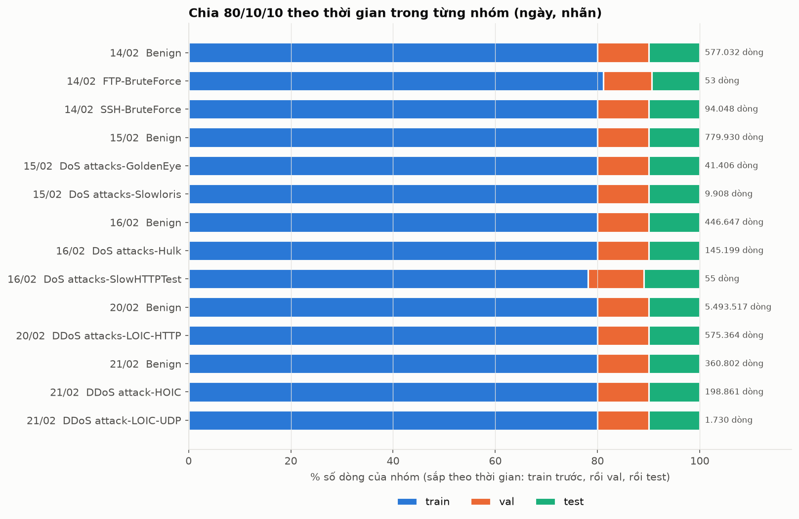

# Hướng dẫn làm phần Data trong dự án MLOps (từng bước)

> Mục đích: sau này vào bất kỳ dự án ML nào và nhận phần **Data**, bạn biết **làm gì, theo thứ tự nào, và vì sao**.
> Ví dụ xuyên suốt: CSE-CIC-IDS2018 (phát hiện xâm nhập mạng).
>
> **Nguồn dữ liệu:** dùng bộ đầy đủ 10 file từ nguồn chính thức của CIC (xem Bước 2), **không dùng** bản Kaggle `primus11` vì nó chỉ có một ngày.
>
> **Cập nhật 28/10/2026:** các **bước 5 đến 13** đã được viết lại theo **cách làm thật của dự án** (`src/data/preprocess.py`, `params.yaml`) và theo các quyết định của nhóm trong `QUYET_DINH.md`. Mỗi bước có phần *"Áp dụng vào dự án này"* cho biết code làm gì, kèm bài học rút ra từ số liệu thật. Các bước 1 đến 4 và 14 không đổi.
>
> **Lưu ý:** tên cột và số liệu trong code là theo hiểu biết về CIC-IDS-2018 gốc. Bản Kaggle có thể khác, nên ở **Bước 3** luôn phải nhìn dữ liệu thật trước rồi mới sửa code cho khớp.

---

## Phần 0. Tư duy trước khi làm

**Phần Data trong MLOps khác gì "làm data cho bài tập ML"?**

| Bài tập ML | Dự án MLOps |
|---|---|
| Mở notebook, làm sạch, train, xong | Mọi bước là **code chạy lại được** bằng một lệnh |
| Sửa dữ liệu tay, quên đã sửa gì | Mỗi thay đổi được **ghi lại và có version** |
| Chia dữ liệu ngẫu nhiên | Chia **có chủ đích** (tránh rò rỉ, mô phỏng thực tế) |
| Chỉ phục vụ lúc train | Dữ liệu và bộ tiền xử lý còn dùng lại ở **API** và **giám sát Drift** |

Người làm Data phải trả lời được 5 câu hỏi:
1. Dữ liệu **đến từ đâu**, phiên bản nào?
2. Dữ liệu **có đáng tin** không (sạch, đúng schema)?
3. Đã **biến đổi** thế nào để ra bộ dữ liệu huấn luyện?
4. Chia tập **có bị rò rỉ** không?
5. Người khác chạy lại có ra **y hệt** không?

Phần còn lại của hướng dẫn là cách trả lời 5 câu này.

---

## Bước 1. Dựng môi trường và khung thư mục

**Vì sao:** môi trường riêng giúp mọi người dùng cùng phiên bản thư viện. Khung thư mục rõ ràng giúp tách *dữ liệu gốc* khỏi *dữ liệu đã xử lý*.

```bash
cd CIC-IDS-MLOps
python3 -m venv .venv
source .venv/bin/activate
pip install pandas pyarrow matplotlib seaborn pandera pyyaml scikit-learn kaggle jupyter pytest
pip freeze > requirements.txt   # chốt phiên bản
```

Khung thư mục (đã có sẵn trong dự án):

```text
data/raw/        # dữ liệu gốc, KHÔNG SỬA TAY, không commit
data/interim/    # bước trung gian (Parquet)
data/processed/  # train / val / test cuối cùng
reports/data/    # báo cáo, biểu đồ
src/data/        # code xử lý
tests/data/      # test
params.yaml      # mọi tham số (không viết cứng trong code)
```

**`.gitignore`** (dữ liệu lớn và bí mật không được đẩy lên Git):

```text
.venv/
data/raw/
data/interim/
data/processed/
kaggle.json
```

> **Quy tắc vàng:** `data/raw` là **bất biến**. Sai ở đâu thì sửa **code** rồi chạy lại, không sửa file gốc.

---

## Bước 2. Lấy dữ liệu và ghi dấu vân tay (checksum)

**Vì sao:** để chứng minh "dữ liệu tôi dùng hôm nay đúng là dữ liệu hôm qua", và phát hiện file tải lỗi.

### 2.1. Chọn nguồn dữ liệu (bài học thực tế)

Bản trên Kaggle (`primus11/cic-ids-2018-dataset`) **chỉ có 1 file `cic.csv`** (342 MB). Kiểm tra bằng EDA cho thấy đó chỉ là **ngày 14/02/2018** của bộ gốc (1.048.575 dòng, 3 nhãn: Benign, FTP-BruteForce, SSH-Bruteforce). Thiếu DoS, DDoS, Botnet, Web Attack, Infiltration và không có nhiều ngày để chia theo thời gian.

> **Bài học:** tên dataset trên Kaggle không đảm bảo là bộ đầy đủ. Trước khi dùng, luôn đối chiếu với **nguồn gốc** (trang của nhóm tác giả) về số file, dung lượng, số nhãn và khoảng thời gian.

Bộ **đầy đủ** lấy từ nguồn chính thức của CIC:
- Trang gốc: <https://www.unb.ca/cic/datasets/ids-2018.html>
- AWS Open Data: <https://registry.opendata.aws/cse-cic-ids2018/> (bucket công khai `s3://cse-cic-ids2018`, vùng `ca-central-1`, **không cần tài khoản AWS**)
- Thư mục cần lấy: `Processed Traffic Data for ML Algorithms/` gồm **10 file CSV** (mỗi ngày một file), tổng **6,4 GiB**. Thư mục `Original Network Traffic and Log data/` là pcap thô, rất nặng, **không cần**.

| File (mỗi file một ngày) | Dung lượng |
|---|---|
| Wednesday-14-02-2018 | 342 MiB |
| Thursday-15-02-2018 | 359 MiB |
| Friday-16-02-2018 | 318 MiB |
| Thuesday-20-02-2018 *(tên gốc viết sai chính tả, giữ nguyên)* | **3,8 GiB** |
| Wednesday-21-02-2018 | 314 MiB |
| Thursday-22-02-2018 | 365 MiB |
| Friday-23-02-2018 | 365 MiB |
| Wednesday-28-02-2018 | 200 MiB |
| Thursday-01-03-2018 | 103 MiB |
| Friday-02-03-2018 | 336 MiB |

(Tên file đầy đủ có hậu tố `_TrafficForML_CICFlowMeter.csv`.)

### 2.2. Kiểm tra trước khi tải (không tải gì cả)

Luôn **liệt kê trước, tải sau** để biết dung lượng và so với ổ đĩa còn trống (`df -h .`):

```bash
python -m awscli s3 ls --no-sign-request --region ca-central-1 --human-readable --summarize \
  "s3://cse-cic-ids2018/Processed Traffic Data for ML Algorithms/"
```

### 2.3. Tải về

Cài AWS CLI vào venv (`pip install awscli`) rồi tải thẳng vào `data/raw/`:

```bash
python -m awscli s3 sync --no-sign-request --region ca-central-1 \
  "s3://cse-cic-ids2018/Processed Traffic Data for ML Algorithms/" data/raw/
```

Giải thích: `sync` chỉ tải file chưa có hoặc đổi kích thước nên **bị ngắt thì chạy lại đúng lệnh cũ để tải tiếp**. `--no-sign-request` nghĩa là truy cập ẩn danh, không cần khóa AWS.

Lưu ý thực tế:
- **Dùng `python -m awscli` thay vì `aws`** nếu đường dẫn dự án có khoảng trắng hoặc dấu tiếng Việt (script `aws` trong venv sẽ lỗi `bad interpreter`).
- Tốc độ khoảng 2 MiB/s thì 6,4 GiB mất gần 1 giờ; không để máy ngủ.
- Trong lúc tải, file có đuôi ngẫu nhiên (ví dụ `.Eb637a00`) là file tạm, sẽ tự đổi tên khi xong.
- Nếu trước đó đã có `cic.csv` từ Kaggle thì file đó **trùng** với `Wednesday-14-02-2018...csv`: xóa một trong hai (sau khi so sánh checksum) để không bị trùng dữ liệu.
- Ổ đĩa phải còn trống thoải mái: 6,4 GiB dữ liệu thô + Parquet trung gian + bản đã xử lý.
- Có thể tải trực tiếp từng file bằng trình duyệt qua link dạng `https://cse-cic-ids2018.s3.ca-central-1.amazonaws.com/Processed%20Traffic%20Data%20for%20ML%20Algorithms/<tên file>`.

### 2.4. Ghi dấu vân tay (checksum)

Viết `src/data/download.py` để tạo `MANIFEST.json` (tên file → SHA-256 → kích thước):

```python
import hashlib, json
from pathlib import Path

RAW = Path("data/raw")

def sha256(path, chunk=1 << 20):
    h = hashlib.sha256()
    with open(path, "rb") as f:
        while block := f.read(chunk):
            h.update(block)
    return h.hexdigest()

manifest = {
    p.name: {"sha256": sha256(p), "bytes": p.stat().st_size}
    for p in sorted(RAW.glob("*.csv"))
}
Path("data/raw/MANIFEST.json").write_text(json.dumps(manifest, indent=2))
print(f"{len(manifest)} files")
```

**Kiểm tra:** `MANIFEST.json` có đủ **10 file**, dung lượng từng file khớp bảng ở mục 2.1 (tổng khoảng 6,4 GiB). Thiếu file hoặc lệch dung lượng nghĩa là tải chưa xong hoặc bị lỗi, hãy chạy lại lệnh `sync`.

---

## Bước 3. Nhìn dữ liệu trước khi làm bất cứ điều gì

**Vì sao:** đây là bước nhiều người bỏ qua nhất và gây lỗi nhiều nhất. Đừng giả định, hãy nhìn.

Mở Jupyter (`jupyter notebook`) và chạy thử trên **một file**:

```python
import pandas as pd
from pathlib import Path

files = sorted(Path("data/raw").glob("*.csv"))
for f in files:
    print(f.name, round(f.stat().st_size / 1e6), "MB")

df = pd.read_csv(files[0], nrows=5000)   # đọc mẫu nhỏ cho nhanh
print(df.shape)
df.head()
df.info()
```

Trả lời các câu hỏi sau và **ghi lại**:

| Câu hỏi | Cách xem |
|---|---|
| Có bao nhiêu file, mỗi file bao nhiêu dòng? | Đếm dòng từng file |
| Tên cột có giống nhau giữa các file không? | So sánh `set(df.columns)` giữa các file |
| Cột nhãn tên gì? Giá trị ra sao? | `df["Label"].value_counts()` |
| Có cột thời gian không, định dạng gì? | `df["Timestamp"].head()` |
| Có cột kiểu `object` mà đáng ra là số không? | `df.info()` |
| Có dòng header bị lặp trong dữ liệu không? | `(df["Label"] == "Label").sum()` |

So sánh cột giữa các file:

```python
cols = {f.name: set(pd.read_csv(f, nrows=1).columns) for f in files}
common = set.intersection(*cols.values())
for name, c in cols.items():
    print(name, "- cột thừa so với các file khác:", c - common)
print("số cột chung:", len(common))
```

> Nếu có file thừa/thiếu cột so với các file khác (trong CIC-IDS-2018 gốc có một file như vậy), đó là một **phát hiện cần ghi vào báo cáo** và xử lý ở Bước 6.

---

## Bước 4. EDA (phân tích khám phá), đây là phần "có biểu đồ"

**Vì sao:** EDA cho bạn **căn cứ** để quyết định cách làm sạch và cách chia tập. Mỗi biểu đồ phải trả lời một câu hỏi cụ thể, không vẽ cho đẹp.

Đầu tiên gộp dữ liệu (đọc từng file, ép kiểu số, downcast để tiết kiệm RAM):

```python
def load_one(path):
    df = pd.read_csv(path, low_memory=False)
    df.columns = df.columns.str.strip()
    df = df[df["Label"] != "Label"]            # bỏ dòng header lặp (nếu có)
    label = df["Label"]
    num = df.drop(columns=["Label"]).apply(pd.to_numeric, errors="coerce")
    num = num.apply(pd.to_numeric, downcast="float")
    num["Label"] = label
    num["source_file"] = path.name
    return num
```

> `errors="coerce"` biến giá trị không phải số thành `NaN`. Cột kiểu thời gian (`Timestamp`) sẽ thành `NaN` nếu ép số, nên xử lý riêng bằng `pd.to_datetime(..., errors="coerce")`. Đây là chỗ cần điều chỉnh theo schema thật.

### Biểu đồ 1: Phân bố nhãn
**Câu hỏi:** dữ liệu cân bằng không?

```python
import matplotlib.pyplot as plt
counts = df["Label"].value_counts()
ax = counts.plot.barh(logy=False)
ax.set_xscale("log")      # thang log vì chênh lệch rất lớn
plt.title("Phân bố nhãn (thang log)")
plt.tight_layout(); plt.savefig("reports/data/figures/label_dist.png", dpi=150)
```
**Rút ra:** nếu Benign áp đảo → không dùng Accuracy; dùng Recall, PR-AUC, FPR; cần xử lý mất cân bằng (chỉ ở tập train).

### Biểu đồ 2: Nhãn theo từng ngày (file)
**Câu hỏi:** loại tấn công nào xuất hiện ở ngày nào? Quyết định cách chia tập.

```python
pd.crosstab(df["source_file"], df["Label"]).plot.bar(stacked=True, logy=True, figsize=(12, 5))
plt.title("Số luồng theo ngày và nhãn")
plt.tight_layout(); plt.savefig("reports/data/figures/label_by_day.png", dpi=150)
```
**Rút ra:** nếu một loại tấn công chỉ có ở một ngày → chia tập theo ngày thuần túy sẽ làm train không thấy loại đó (xem Bước 10).

### Biểu đồ 3: Dữ liệu lỗi theo cột
**Câu hỏi:** cột nào có `NaN`, `inf`, giá trị âm?

```python
import numpy as np
X = df.drop(columns=["Label", "source_file"]).select_dtypes("number")
bad = pd.DataFrame({
    "nan": X.isna().mean(),
    "inf": np.isinf(X).mean(),
    "neg": (X < 0).mean(),
})
bad[bad.sum(axis=1) > 0].sort_values("nan", ascending=False).plot.bar(figsize=(12, 4))
plt.title("Tỉ lệ NaN / inf / giá trị âm theo cột")
plt.tight_layout(); plt.savefig("reports/data/figures/bad_values.png", dpi=150)
```
**Rút ra:** danh sách cột cần xử lý ở bước làm sạch.

### Biểu đồ 4: Trùng lặp và cột hằng số
```python
print("dòng trùng:", X.duplicated().sum(), f"({X.duplicated().mean():.2%})")
const_cols = [c for c in X.columns if X[c].nunique(dropna=True) <= 1]
print("cột hằng số:", const_cols)
```

### Biểu đồ 5: Tương quan giữa các đặc trưng
**Câu hỏi:** có đặc trưng nào gần như giống hệt nhau (thừa) không?

```python
import seaborn as sns
sample = X.sample(min(len(X), 200_000), random_state=42)   # lấy mẫu cho nhanh
corr = sample.corr()
plt.figure(figsize=(14, 12)); sns.heatmap(corr, cmap="coolwarm", center=0)
plt.tight_layout(); plt.savefig("reports/data/figures/corr.png", dpi=120)
```

### Biểu đồ 6: Benign so với Attack trên vài đặc trưng chính
```python
feat = ["Flow Duration", "Tot Fwd Pkts", "Pkt Len Mean"]   # đổi theo tên cột thật
for c in feat:
    sns.boxplot(data=sample.assign(y=df.loc[sample.index, "Label"] != "Benign"),
                x="y", y=c, showfliers=False)
    plt.yscale("symlog"); plt.title(c); plt.show()
```
**Rút ra:** đặc trưng nào phân tách tốt hai lớp.

> **Mẹo viết báo cáo:** dưới mỗi biểu đồ ghi 1 đến 2 câu: *"Quan sát → Hệ quả cho quyết định xử lý"*. Đó là điều làm phần Data có giá trị.

---

## Bước 5. Ghi quyết định vào `params.yaml` *(cập nhật 28/10)*

**Vì sao:** các quyết định (cột nào bỏ, chia thế nào, seed bao nhiêu) phải nằm ở **một chỗ**, đọc được và thay đổi được mà không sửa code. Mẹo: mỗi tham số ghi kèm **số của quyết định nhóm** (`#1`, `#2`...) để truy vết lý do.

**Áp dụng vào dự án này** (`params.yaml`, rút gọn):

```yaml
data:
  raw_dir: data/raw                  # ghi đè được bằng biến môi trường CIC_RAW_DIR
  processed_dir: data/processed      # train / val / test / production_sim (.parquet)
  artifacts_dir: data/preprocessing  # features.json, label_map.json, dropped_features.json
  seed: 42
clean:
  drop_id_cols: [Flow ID, Src IP, Dst IP, Src Port]
  drop_constant_cols: [Bwd PSH Flags, ...]        # 8 cột hằng số, từ EDA (#11)
  allow_negative_cols: [Init Fwd Win Byts, Init Bwd Win Byts]   # giữ giá trị -1 (#6)
  add_window_flags: true                          # thêm cột cờ (#6)
  dedup: features                                 # loại trùng theo đặc trưng + nhãn, bỏ qua Timestamp (#1)
time:
  pm_hours: [1, 7]                                # giả định AM/PM (#4)
label:
  merge: {"Brute Force -Web": "Web Attack", ...}  # gộp lớp Web (#9)
split:
  train_last_day: "2018-02-21"                    # ngày đến hết 21/02 -> train/val/test, sau đó -> production_sim (#2)
  train: 0.8
  val: 0.1
  test: 0.1                                       # chia theo thời gian trong từng nhóm (ngày, nhãn) (#3)
features:
  drop_correlated: false                          # ngưỡng tương quan chưa chốt (#11) nên mặc định tắt
```

---

## Bước 6. Đọc theo chunk và lưu Parquet trung gian *(cập nhật 28/10)*

**Vì sao Parquet?** Nhỏ hơn CSV nhiều lần, đọc nhanh, **nhớ kiểu dữ liệu** (CSV thì mỗi lần đọc lại phải đoán). **Vì sao đọc theo chunk?** File ngày 20/02 nặng 4 GB (7,9 triệu dòng), không nên nạp một lần vào RAM.

```python
for i, chunk in enumerate(pd.read_csv(f, chunksize=500_000, low_memory=False)):
    num, raw, merged, tsec = clean_chunk(chunk, feature_cols, cfg, stats)   # làm sạch ngay từng chunk
    out = num.astype("float32")        # float32: nhỏ gần một nửa float64, đủ chính xác cho mô hình
    out.to_parquet(parts_dir / f"{date:%Y%m%d}_{i:04d}.parquet", compression="zstd")
```

**Áp dụng vào dự án này:** ingest và làm sạch nằm chung một lượt đọc (không có file `ingest.py` riêng). Các phần sạch lưu tạm ở `data/interim/clean_parts/` và tự xóa khi chạy xong. Khóa băm để so trùng được tính trên `float64` **trước khi** chuyển sang `float32`, để hai giá trị khác nhau nhẹ không bị coi nhầm là trùng.

> Nếu ở Bước 3 bạn thấy file thừa/thiếu cột: giữ **tập cột chung**, hoặc thêm cột còn thiếu bằng `NaN`. Ở dự án này, 4 cột thừa của file 20/02 (`Flow ID`, `Src IP`, `Src Port`, `Dst IP`) đều là cột định danh nên bị bỏ, và hai bên khớp nhau.

---

## Bước 7. Validate: kiểm tra dữ liệu tự động

**Vì sao:** để pipeline **tự dừng** khi dữ liệu sai, thay vì lặng lẽ train trên dữ liệu hỏng. Đây là điểm đặc trưng của MLOps.

Cách đơn giản nhất (assert) rồi nâng cấp lên Pandera/Great Expectations:

```python
# src/data/validate.py
import numpy as np, pandas as pd

def validate(df, label_col="Label", allowed_labels=None, max_null=0.01):
    errors = []
    if label_col not in df.columns:
        errors.append("Thiếu cột nhãn")
    elif allowed_labels is not None:
        unknown = set(df[label_col].unique()) - set(allowed_labels)
        if unknown:
            errors.append(f"Nhãn lạ: {unknown}")
    num = df.select_dtypes("number")
    if np.isinf(num).any().any():
        errors.append("Còn giá trị inf")
    null_rate = num.isna().mean().max()
    if null_rate > max_null:
        errors.append(f"Tỉ lệ NaN cao nhất {null_rate:.2%} > {max_null:.0%}")
    if errors:
        raise ValueError("Validate thất bại:\n- " + "\n- ".join(errors))
```

Chạy validate **hai lần**: sau Ingest (để biết dữ liệu gốc lỗi thế nào, có thể chỉ cảnh báo) và sau Clean (phải đạt, nếu không thì dừng).

---

> **Áp dụng vào dự án này:** chưa viết `validate.py`. Thay vào đó, kết quả sau xử lý được kiểm tra bằng bộ test ở Bước 13 (không `NaN`/`inf`, đúng schema, đúng cách chia). Nếu có thêm thời gian, nên bổ sung bước kiểm tra schema trên dữ liệu thô trước khi làm sạch.

---

## Bước 8. Làm sạch có thống kê *(cập nhật 28/10)*

**Vì sao thống kê?** Mỗi lần xóa dòng là một quyết định ảnh hưởng đến mô hình, cần có số liệu trước và sau.

**Áp dụng vào dự án này** (`clean_chunk` trong `src/data/preprocess.py`), theo thứ tự:

| # | Quy tắc | Số dòng bị loại | Nguồn quyết định |
|---|---|---:|---|
| 1 | Dòng header bị lặp trong dữ liệu | 59 | EDA |
| 2 | `Timestamp` không đọc được hoặc sai năm (1970) | 14 | EDA |
| 3 | Có `NaN` hoặc `inf` (luồng thời lượng 0 nên chia cho 0) | 95.760 | #5 |
| 4 | Có giá trị âm ở cột không cho phép (giữ −1 của `Init Win Byts`) | 1 | EDA, #6 |
| 5 | Dòng trùng trên đặc trưng + nhãn, bỏ qua `Timestamp` | 4.220.857 | #1 |

```python
num = chunk[feature_cols].apply(pd.to_numeric, errors="coerce").astype("float64")
num = num.replace([np.inf, -np.inf], np.nan)
miss = num.isna().any(axis=1)                      # NaN hoặc inf
neg = (num[neg_cols] < 0).any(axis=1)              # neg_cols = mọi cột trừ Init Fwd/Bwd Win Byts
```

Ngoài ra bỏ cột: 4 cột định danh, `Timestamp`, 8 cột hằng số. Kết quả ghi ở `reports/data/cleaning_report.json` (số dòng từng bước, từng ngày, từng nhãn).

### Loại dòng trùng: bài học quan trọng

Câu hỏi "thế nào là dòng trùng" quyết định kết quả rất khác nhau. Trên 16,1 triệu dòng sau làm sạch:

| Cách định nghĩa trùng | Số dòng bị loại | FTP-BruteForce còn | SlowHTTPTest còn |
|---|---:|---:|---:|
| Trùng **cả thời điểm** (`exact`) | 431.731 (2,7%) | 39.346 | 19.462 |
| Trùng **đặc trưng + nhãn**, bỏ qua `Timestamp` (`features`, **đang dùng theo #1**) | 4.220.857 (26,2%) | **53** | **55** |

Lý do: hai loại tấn công này được tạo bởi công cụ gửi **cùng một mẫu gói tin lặp đi lặp lại**, chỉ khác thời điểm. Vì `Timestamp` không được dùng làm đặc trưng, về mặt mô hình các dòng đó là **một**, nhưng cũng vì vậy hai lớp gần như biến mất. **Bài học:** sau mỗi bước xóa dòng, luôn in số dòng **từng nhãn** trước và sau. Nếu một lớp mất hơn 90%, dừng lại và hỏi lại quyết định.

```python
fkl = fkey * PRIME + codes                                   # hash(đặc trưng) kết hợp nhãn, KHÔNG có Timestamp
dup = pd.Series(fkl[order]).duplicated(keep="first")         # order: sắp theo thời gian, nên giữ dòng sớm nhất
```

> **Cảnh báo:** loại trùng phải làm **trước khi chia** để cùng một bản ghi không rơi vào cả train lẫn test.

---

## Bước 9. Gán nhãn *(cập nhật 28/10)*

**Áp dụng vào dự án này:**
1. **Chuẩn hóa tên** (#10): `DDOS attack-HOIC` thành `DDoS attack-HOIC`, `Infilteration` thành `Infiltration`, `SSH-Bruteforce` thành `SSH-BruteForce`.
2. **Gộp lớp quá hiếm** (#9): `Brute Force -Web` (611), `Brute Force -XSS` (230), `SQL Injection` (87) thành một lớp `Web Attack`. Nhãn gốc vẫn giữ ở cột `Label_raw`.
3. Tạo hai cột đích: `y_binary` (0 = Benign, 1 = Attack) và `y_multi` (mã 0 đến 12 theo `label_map`).
4. Lưu `label_map.json` vào `data/preprocessing/` để API và giám sát dùng lại.

```python
labels_sorted = ["Benign"] + sorted(other_labels)            # Benign luôn là 0
label_map = {name: i for i, name in enumerate(labels_sorted)}
```

---

## Bước 10. Chia tập (train / val / test), bước dễ sai nhất *(cập nhật 28/10)*

**Rò rỉ dữ liệu (data leakage)** là khi thông tin của tập test "lọt" vào lúc train, khiến kết quả đẹp giả tạo. Với dữ liệu mạng, chia ngẫu nhiên nghĩa là các luồng cùng một phiên tấn công nằm cả trong train và test → mô hình "nhớ" thay vì "hiểu".

Ba cách chia, và kết luận của nhóm:

| Cách chia | Ưu | Nhược | Kết luận |
|---|---|---|---|
| Ngẫu nhiên | Đơn giản | Rò rỉ giữa các luồng cùng phiên tấn công | Không dùng |
| Cắt 80/10/10 theo thời gian **trên cả ngày** | Sát thực tế | Tấn công chỉ kéo dài vài giờ, nên val/test thiếu hầu hết loại tấn công (xem `QUYET_DINH.md`, Phụ lục 2) | Không dùng |
| **Theo thời gian, trong từng nhóm (ngày, nhãn)** | Giữ thứ tự thời gian trong mỗi phiên tấn công mà tập nào cũng đủ lớp | Lớp rất nhỏ chỉ còn vài mẫu ở val/test | **Dùng (#3)** |

**Áp dụng vào dự án này:**

1. **Chia theo giai đoạn (#2):** các ngày 14/02 đến 21/02 chia train/val/test; các ngày 22/02 đến 02/03 là `production_sim` (không chia), để mô phỏng dữ liệu vận hành và Drift. Ba nhóm tấn công mới (Web, Infiltration, Bot) chỉ xuất hiện ở giai đoạn sau, nên mô hình ban đầu chưa từng thấy chúng.
2. **Sắp thứ tự theo thời gian, với giả định AM/PM (#4):** `Timestamp` chỉ có giờ 1 đến 12 (mất AM/PM). Giờ 1 đến 7 được hiểu là buổi chiều (cộng 12). Các dòng có cùng `Timestamp` giữ nguyên thứ tự gốc (sắp ổn định).
3. **Trong từng nhóm (ngày, nhãn):** 80% dòng sớm nhất là train, 10% kế là val, 10% muộn nhất là test.

```python
for day in train_days:
    for label in labels:
        rows = order[(day_of_row == day) & (label_of_row == label) & kept]   # đã sắp theo thời gian
        m = len(rows); n_val = n_test = max(1, round(0.1 * m))
        split[rows[: m - n_val - n_test]] = TRAIN
        split[rows[m - n_val - n_test : m - n_test]] = VAL
        split[rows[m - n_test :]] = TEST
```



**Kiểm tra bắt buộc sau khi chia** (đều có trong `tests/data/test_processed.py`):
- Các tập **không giao nhau**, kể cả `production_sim`.
- Trong mỗi nhóm: train sớm hơn val, val sớm hơn test.
- Tập nào cũng có đủ các lớp cần thiết (in `value_counts`).
- Ghi vào báo cáo kích thước và phân bố nhãn của từng tập (`reports/data/split_report.json`).

> **Lưu ý thật sự quan trọng:** vì quyết định #1 làm FTP-BruteForce chỉ còn 53 dòng và SlowHTTPTest còn 55 dòng, hai nhóm này chia ra **43 / 5 / 5** và **43 / 6 / 6**. Chỉ số của hai lớp này trên val/test dựa trên 5 đến 6 mẫu, nên gần như không có ý nghĩa thống kê.

---

## Bước 11. Tiền xử lý: phần nào thuộc dữ liệu, phần nào thuộc mô hình *(cập nhật 28/10)*

**Nguyên tắc:** bất cứ thứ gì "học" từ dữ liệu (trung bình, độ lệch chuẩn, trọng số lớp) chỉ được học từ **train**. Vì vậy các việc đó **không** làm trong pipeline dữ liệu, mà đặt trong pipeline của mô hình.

**Pipeline dữ liệu làm (`preprocess.py`)**, không cần học từ dữ liệu:
- Thêm hai cột cờ (#6): `fwd_win_missing = 1` khi `Init Fwd Win Byts == -1`, tương tự `bwd_win_missing`. Giá trị −1 gốc **giữ nguyên**. Lý do: −1 nghĩa là "không có cửa sổ TCP" (UDP, hoặc không có gói chiều về), chiếm 20% đến 37% số dòng; xóa đi sẽ mất gần hết vài loại tấn công (ví dụ DDoS LOIC-UDP có 100% dòng −1).
- Chỉ xuất 72 đặc trưng (70 gốc + 2 cờ) cùng các cột nhãn. Các cột `meta_day`, `meta_time`, `meta_key` dùng để truy vết và kiểm tra, **không đưa vào mô hình**.

**Mô hình làm (khi huấn luyện)**, vì cần học từ train:
- **RobustScaler chỉ cho SVM** (#14), đặt **trong `Pipeline`** để chỉ `fit` trên train và tự áp dụng đúng cho val/test; XGBoost không cần scale.
- **Trọng số lớp** (#13), không dùng SMOTE: XGBoost dùng `scale_pos_weight = số Benign / số Attack trên train` (khoảng 7,18 với dữ liệu hiện tại); SVM dùng `class_weight="balanced"`.

```python
import json, pandas as pd
from sklearn.pipeline import make_pipeline
from sklearn.preprocessing import RobustScaler
from sklearn.svm import SVC

features = json.load(open("data/preprocessing/features.json", encoding="utf-8"))
train = pd.read_parquet("data/processed/train.parquet", columns=features + ["y_binary"])
spw = (train["y_binary"] == 0).sum() / (train["y_binary"] == 1).sum()     # cho XGBoost
svm = make_pipeline(RobustScaler(), SVC(class_weight="balanced"))          # scaler nằm trong Pipeline
```

- **Vì sao lưu `features.json`, `label_map.json`?** API khi nhận request mới phải dùng **đúng** danh sách và thứ tự đặc trưng như lúc train, nếu không sẽ bị *train–serve skew* (lệch giữa huấn luyện và phục vụ).

Dữ liệu cuối cùng nằm ở `data/processed/`: `train.parquet`, `val.parquet`, `test.parquet`, `production_sim.parquet`. Các file nhỏ dùng lại khi huấn luyện và phục vụ nằm ở `data/preprocessing/`.

---

## Bước 12. Tái lập được: ghi lại mọi thứ

Tối thiểu mỗi lần huấn luyện phải log vào MLflow:
- `params.yaml` (các tham số dữ liệu)
- Hash của dữ liệu đầu vào (từ `MANIFEST.json`)
- Số dòng và phân bố nhãn của train/val/test
- Artifact: `features.json`, `label_map.json` (trong `data/preprocessing/`); scaler của SVM nằm trong `Pipeline` của mô hình nên được log cùng mô hình

```python
import mlflow
with mlflow.start_run():
    mlflow.log_artifact("params.yaml")
    mlflow.log_artifact("data/raw/MANIFEST.json")
    mlflow.log_dict({"train": len(train), "val": len(val), "test": len(test)}, "data_sizes.json")
```

Nâng cao: dùng **DVC** để gắn version dữ liệu với commit Git (`dvc init`, `dvc add data/processed`, `dvc remote add ...`, `dvc push`).

---

## Bước 13. Viết test cho code dữ liệu *(cập nhật 28/10)*

**Áp dụng vào dự án này:** `tests/data/test_processed.py` có 9 test, chạy bằng `python -m pytest tests/data`. Mỗi test kiểm tra một quyết định của nhóm:

| Test | Kiểm tra | Quyết định |
|---|---|---|
| `test_same_schema` | 4 file Parquet cùng schema, đúng thứ tự cột theo `features.json` | |
| `test_no_leaky_or_dropped_columns` | Không còn `Timestamp`, IP, cổng nguồn, cột hằng số | #11 |
| `test_no_missing_or_inf_in_features` | Mọi đặc trưng đều là số hữu hạn | #5 |
| `test_window_flags_keep_minus_one` | Vẫn còn giá trị −1; cột cờ khớp đúng với −1 | #6 |
| `test_days_per_split` | train/val/test chỉ có ngày đến 21/02; `production_sim` chỉ có ngày sau | #2 |
| `test_group_split_ratio_and_time_order` | Mỗi nhóm (ngày, nhãn) chia 80/10/10; train sớm hơn val, val sớm hơn test | #3, #4 |
| `test_dedup_on_features_and_label` | Không còn dòng trùng, không có dòng nào xuất hiện ở hai tập | #1 |
| `test_labels_consistent` | `y_multi`, `y_binary` khớp `Label`; lớp Web đã gộp, nhãn gốc còn ở `Label_raw` | #9, #10 |
| `test_every_train_label_in_every_split` | Val và test có đúng các nhãn như train | |

```python
def test_dedup_on_features_and_label(meta):
    keys = [np.sort(meta[n]["meta_key"].to_numpy()) for n in ALL]
    for i in range(len(ALL)):
        for j in range(i + 1, len(ALL)):
            assert len(np.intersect1d(keys[i], keys[j])) == 0      # không có dòng nào ở hai tập
```

Nguyên tắc: **viết test theo từng quyết định**, để khi ai đó đổi `params.yaml` mà làm hỏng một quyết định thì test báo ngay.

---

## Bước 14. Viết báo cáo / Data Card

Một báo cáo Data tốt có bố cục:
1. **Nguồn và phạm vi** của dữ liệu (kèm hash/phiên bản)
2. **EDA** (các biểu đồ ở Bước 4 + nhận xét ngắn)
3. **Vấn đề chất lượng phát hiện được** (kèm số liệu)
4. **Quy tắc làm sạch** và số dòng trước/sau
5. **Cách gán nhãn** và **cách chia tập** (kèm lý do)
6. **Tiền xử lý** và artifact tạo ra
7. **Giới hạn đã biết** (dữ liệu mô phỏng, mất cân bằng, v.v.)
8. **Cách chạy lại** (các lệnh)

---

## Phụ lục A. Lỗi người mới hay mắc

| Lỗi | Hậu quả | Cách tránh |
|---|---|---|
| Scale/chọn đặc trưng **trước** khi chia tập | Rò rỉ thông tin test | Chia trước, `fit` chỉ trên train |
| Chia ngẫu nhiên dữ liệu có yếu tố thời gian | Kết quả đẹp giả | Chia theo thời gian |
| Giữ IP, Flow ID làm đặc trưng | Mô hình học thuộc máy | Bỏ cột định danh |
| Dùng Accuracy khi dữ liệu mất cân bằng | 99% nhưng bỏ sót hết tấn công | Dùng Recall, PR-AUC, FPR |
| Cân bằng lớp trên cả val/test | Đánh giá sai thực tế | Chỉ cân bằng train |
| Sửa file trong `data/raw` | Không tái lập được | Raw bất biến, sửa bằng code |
| Hard-code tham số trong code | Khó thay đổi, khó ghi lại | Đưa vào `params.yaml` |
| Quên lưu scaler | API không tiền xử lý giống lúc train | Log artifact vào MLflow |
| Loại trùng mà không xem hậu quả **theo từng lớp** | Hai lớp (FTP-BruteForce, SlowHTTPTest) chỉ còn 53 và 55 dòng | In số dòng từng nhãn trước và sau mỗi bước xóa; nếu một lớp mất hơn 90% thì hỏi lại quyết định |
| Cắt 80/10/10 theo thời gian trên **cả ngày** | Val/test thiếu hầu hết loại tấn công (tấn công chỉ kéo dài vài giờ) | Chia trong từng nhóm (ngày, nhãn) |
| Xóa dòng có giá trị −1 ở cột cửa sổ TCP | Mất gần hết vài loại tấn công, lệch giữa huấn luyện và vận hành | Giữ giá trị, thêm cột cờ |
| Đưa cột `meta_*` hoặc cột nhãn vào mô hình | Rò rỉ nhãn | Chỉ lấy cột trong `features.json` |

## Phụ lục B. Checklist cho **bất kỳ** dự án nào (dùng lại sau này)

- [ ] Dữ liệu đến từ đâu, phiên bản nào, giấy phép gì?
- [ ] Có `MANIFEST`/checksum hoặc DVC không?
- [ ] Đã **nhìn** dữ liệu thật (schema, kiểu, nhãn, thời gian) chưa?
- [ ] EDA trả lời được: cân bằng lớp, lỗi dữ liệu, trùng lặp, phân bố theo thời gian?
- [ ] Biết cột nào có thể gây **rò rỉ** (ID, thời gian, thông tin sinh ra sau nhãn)?
- [ ] Có bước validate tự động và pipeline dừng khi sai không?
- [ ] Chia tập có phản ánh cách mô hình sẽ dùng thực tế không?
- [ ] Mọi bước học tham số chỉ fit trên train?
- [ ] Artifact tiền xử lý đã được lưu để API dùng lại?
- [ ] Chạy lại từ đầu có ra kết quả giống hệt (cùng seed, cùng hash)?
- [ ] Có test và có tài liệu (Data Card)?
- [ ] Sau mỗi bước xóa dòng, đã in số dòng **từng nhãn** trước và sau chưa?
- [ ] Mỗi tham số trong `params.yaml` có ghi quyết định nào của nhóm không?
