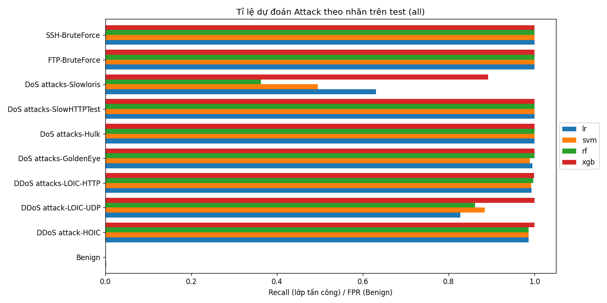
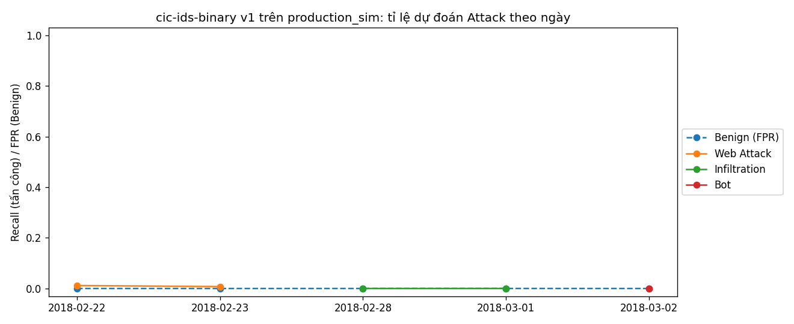

# Model – Phát triển mô hình và quản lý thí nghiệm

> Phạm vi: huấn luyện LR, SVM, XGBoost (thêm Random Forest theo README), tinh chỉnh
> siêu tham số, đánh giá, MLflow Tracking, MLflow Model Registry và cơ chế so sánh mô hình hiện tại với mô hình mới.
> Code: `src/models/`. Tham số: `models.yaml` (tách khỏi `params.yaml` của pipeline dữ liệu để tránh xung đột).
> Đầu vào là kết quả của bước tiền xử lý dữ liệu: `data/processed/*.parquet`, `data/preprocessing/features.json`, `label_map.json`.
> Số `#n` là số điểm trong [QUYET_DINH.md](QUYET_DINH.md).

## Mục lục

1. [Cách chạy](#1-cách-chạy)
2. [Thiết kế huấn luyện](#2-thiết-kế-huấn-luyện)
3. [MLflow Tracking: log những gì](#3-mlflow-tracking-log-những-gì)
4. [Model Registry và hợp đồng nạp mô hình (cho API)](#4-model-registry-và-hợp-đồng-nạp-mô-hình-cho-api)
5. [Champion–Challenger (cho tái huấn luyện)](#5-championchallenger-cho-tái-huấn-luyện)
6. [Kết quả](#6-kết-quả)
7. [Hạn chế và việc tiếp theo](#7-hạn-chế-và-việc-tiếp-theo)
8. [Điểm cần nhóm chốt (phần Model)](#8-điểm-cần-nhóm-chốt-phần-model)

---

## 1. Cách chạy

Chạy từ thư mục gốc của repo, sau khi đã có `data/processed/` (`python src/data/preprocess.py`, xem DATA.md mục 8).

```bash
# 1. Huấn luyện 4 mô hình, tìm siêu tham số, đăng ký bản tốt nhất với alias @challenger (khoảng 6 phút, máy 14 nhân)
python -m src.models.train --tune --register

# 2. Champion–Challenger trên test.parquet; lần đầu chưa có champion thì challenger lên @champion nếu đạt FPR
python -m src.models.compare --promote

# 3. #12: XGBoost không có Dst Port, Protocol -> đăng ký -> so với champion
python -m src.models.train --models xgb --feature-set no_port_proto --tune --register
python -m src.models.compare --promote

# 4. Đánh giá champion trên production_sim theo từng ngày (mốc cho Kịch bản 1)
python -m src.models.evaluate --model champion --data data/processed/production_sim.parquet

# Xem thí nghiệm
mlflow ui --backend-store-uri sqlite:///mlruns/mlflow.db       # http://127.0.0.1:5000

# Test (dữ liệu tổng hợp, khoảng 10 giây, không cần data/processed)
python -m pytest tests/models
```

Chạy thử nhanh trên dữ liệu nhỏ: `python src/data/preprocess.py --smoke`, sau đó thêm `--smoke` vào các lệnh trên
(dùng experiment và tên mô hình có hậu tố `-smoke`, ghi báo cáo vào `data/interim/smoke/reports/`).

Khi có MLflow server (bước triển khai, Docker Compose): đặt `MLFLOW_TRACKING_URI=http://<host>:5000`, không cần sửa code.

---

## 2. Thiết kế huấn luyện

### 2.1. Dữ liệu vào

| Tập | Dùng để | Ghi chú |
|---|---|---|
| `train.parquet` | Huấn luyện | Lấy mẫu **20% Benign ngày 20/02** khi nạp (#7 đã chốt lấy mẫu, tỉ lệ chưa chốt; đây là tỉ lệ đề xuất). Giữ mọi dòng Attack và Benign các ngày khác. File dữ liệu không bị sửa |
| `val.parquet` | Tìm siêu tham số, dừng sớm XGBoost, chọn ngưỡng, chọn mô hình tốt nhất | Không lấy mẫu |
| `test.parquet` | Báo cáo cuối và holdout mặc định của Champion–Challenger | Không lấy mẫu, không dùng cho bất kỳ lựa chọn nào |
| `production_sim.parquet` | Đánh giá offline (`evaluate.py`), mốc cho bước giám sát | Có Web Attack, Infiltration, Bot mà train không có |

Chỉ các cột trong `features.json` vào mô hình; `meta_*` và nhãn không bao giờ vào X (DATA.md, mục 9).
Lý do lấy mẫu 20/02: ngày này chiếm 4,39 triệu trên 6,13 triệu dòng Benign của train; giữ hết thì tốn gấp đôi RAM mà
chủ yếu thêm Benign của cùng một ngày. Với 0,2, train còn 3.463.680 dòng (24,6% Attack).

### 2.2. Mô hình

| Mô hình | Vai trò | Cách xử lý | Số dòng train |
|---|---|---|---|
| Logistic Regression | Baseline | `sign(x)·log1p(|x|)` → `RobustScaler` → LR, `class_weight="balanced"` | 500.000 (lấy mẫu phân tầng theo `Label`) |
| Linear SVM (`LinearSVC`) | Đối chứng tuyến tính | Như LR | 500.000 |
| Random Forest | Đối chứng cây (README) | `class_weight="balanced_subsample"`, không scale | 1.500.000 |
| **XGBoost** | Mô hình chính | `tree_method="hist"`, `scale_pos_weight` = Benign/Attack của tập train thực dùng (#13), dừng sớm theo `aucpr` trên val | Toàn bộ (3,46 triệu) |

- **#13** trọng số lớp, không SMOTE; `scale_pos_weight` tính lại mỗi lần huấn luyện (với lấy mẫu 20/02 là 3,06, không phải 7,18 như trên toàn bộ train).
- **#14** scaler chỉ cho mô hình tuyến tính, nằm trong `Pipeline` nên được log cùng mô hình. #14 chỉ nhắc SVM; LR cũng là mô hình tuyến tính (lbfgs không hội tụ khi không scale) nên dùng cùng Pipeline. `log1p` có dấu vì có giá trị −1 (#6), `log1p(-1)` sẽ ra `-inf`.
- **SVM kernel** (`SVC`) không khả thi với hàng triệu dòng (thời gian O(n²) trở lên), nên dùng `LinearSVC`. `LinearSVC` không có xác suất; điểm dùng `sigmoid(decision_function)`, giữ thứ tự nên ROC-AUC/PR-AUC không đổi, nhưng **không phải xác suất đã hiệu chỉnh**.
- Không xáo trộn dữ liệu: cả 4 thuật toán học trên toàn batch hoặc tự lấy mẫu ngẫu nhiên, không phụ thuộc thứ tự dòng.
- **Bộ nhớ:** mỗi mô hình chạy trong một tiến trình con riêng và chỉ nạp đúng số dòng nó cần (lấy mẫu ngay khi đọc
  Parquet). Chạy chung một tiến trình thì heap còn sót của LR/SVM/RF cộng dồn và XGBoost bị kill ở giới hạn 3,5 GB.
  Đỉnh RAM đo được của cả lượt chạy: khoảng 3,1 GB. XGBoost nhận mảng numpy thay vì DataFrame (DataFrame làm XGBoost
  chép thêm khoảng 1 GB).

### 2.3. Tinh chỉnh siêu tham số

Tìm ngẫu nhiên (`ParameterSampler`, seed 42) trên **600.000 dòng** lấy mẫu phân tầng từ train, chấm **PR-AUC trên val**
(không phụ thuộc ngưỡng, hợp với dữ liệu mất cân bằng). 8 lần thử cho RF và XGBoost; LR và SVM thử hết lưới `C`.
Với cây, PR-AUC trên val gần như bão hòa (XGBoost: 0,999999 đến 1,000000 ở cả 8 lần thử), nên các lần thử có PR-AUC
cách tốt nhất không quá 1e-5 được xếp tiếp theo **số lỗi (FP + FN) ở ngưỡng chọn trên val**, rồi đến thời gian huấn luyện.
Mỗi lần thử là một run con trên MLflow. Tham số tốt nhất được huấn luyện lại trên số dòng ở bảng 2.2.
Không gian tìm kiếm ở `models.yaml`, mục `models.<tên>.search`.

### 2.4. Ngưỡng phân loại

Chọn trên val: **F1 lớn nhất trong các ngưỡng có FPR ≤ 1%** (`threshold` trong `models.yaml`). Ngưỡng được lưu trong
mô hình (metadata), nên API và Champion–Challenger dùng đúng ngưỡng của từng phiên bản.

### 2.5. Chỉ số

Accuracy, Precision, **Recall**, F1, Macro-F1, ROC-AUC, PR-AUC, **FPR**, ma trận nhầm lẫn, và **tỉ lệ dự đoán Attack
theo từng nhãn chi tiết** (với lớp tấn công là recall của lớp đó, với Benign là FPR). Chỉ số theo từng lớp là yêu cầu của
Drift Scenarios mục 1.4: phát hiện mô hình bỏ sót một loại tấn công dù chỉ số tổng thể vẫn tốt. Accuracy được log cho đủ
yêu cầu nhưng không dùng để chọn (Benign chiếm đa số).

Thời gian suy luận: trung vị 5 lần cho 1 dòng và cho 1.000 dòng.

---

## 3. MLflow Tracking: log những gì

Experiment `cic-ids-binary`. Mỗi lần chạy `train.py` là một run cha (session), mỗi mô hình là một run con, mỗi lần thử
siêu tham số là một run cháu.

| Cấp | Nội dung |
|---|---|
| Run cha | `models.yaml`, `params.yaml`, `features.json`, `label_map.json`, `split_report.json`, `MANIFEST.json` (thư mục `config/`); SHA-256 của các file Parquet (`data/fingerprint.json`); số dòng, phân bố nhãn (`data/sizes.json`); `summary.json`; biểu đồ recall theo nhãn của các mô hình; tag `best_model`, `registered_version` |
| Run con (mỗi mô hình) | Tham số mô hình, số dòng train, `scale_pos_weight`, cách lấy mẫu; chỉ số `val_*`, `test_*`, `test_rate__<nhãn>`, thời gian huấn luyện và suy luận, ngưỡng; `eval/val.json`, `eval/test.json`, `eval/feature_importance.json`, biểu đồ ma trận nhầm lẫn + PR + ROC; bảng các lần thử (`tuning/trials.json`); **mô hình pyfunc** |
| Tag | `model_type`, `feature_set`, `session`, `stage`; commit Git được MLflow tự ghi (`mlflow.source.git.commit`) |

Tracking mặc định là SQLite cục bộ `mlruns/mlflow.db`, artifact ở `mlruns/artifacts/` (thư mục `mlruns/` bị `.gitignore`
chặn). Bản tóm tắt nhỏ (`reports/models/*.json`, `*.png`) được ghi vào repo để người không mở MLflow vẫn xem được.

---

## 4. Model Registry và hợp đồng nạp mô hình (cho API)

> **Đề xuất, cần phần triển khai API xác nhận.** Các mục dưới đây trả lời 4 câu hỏi của mục 3.2 trong bản phân công.

| Câu hỏi (mục 3.2) | Đề xuất |
|---|---|
| Tên mô hình trong Registry | `cic-ids-binary` (khi làm đa lớp: `cic-ids-multiclass`) |
| Phiên bản dùng khi suy luận | Theo **alias**, không theo số: API nạp `models:/cic-ids-binary@champion`. `@challenger` là bản mới chờ so sánh; `@previous` là champion trước đó. Rollback = trỏ `@champion` về bản `@previous`. Chỉ `compare.py` được chuyển `@champion`. (MLflow đã bỏ "stage" Staging/Production, alias là cách thay thế) |
| Định dạng lưu mô hình và tiền xử lý đi kèm | **MLflow pyfunc** (`src/models/pyfunc.py`): một artifact chứa estimator (kèm scaler nếu là mô hình tuyến tính), danh sách và thứ tự đặc trưng, ngưỡng. Kèm `features.json`, `label_map.json`, `requirements.txt` ghim phiên bản. API **không** tự tiền xử lý → không có train–serve skew |
| Cấu trúc kết quả, xử lý lỗi | Xem bên dưới |

**Đầu vào** `model.predict(df)`: DataFrame, mỗi dòng một luồng, cột theo tên trong `features.json`.
- Thừa cột thì bỏ qua; thứ tự cột không quan trọng.
- Hai cột cờ `fwd_win_missing`, `bwd_win_missing` **không cần gửi**: mô hình luôn tự tính từ `Init Fwd/Bwd Win Byts == -1` (giống `preprocess.py`).
- **Kiểu `float64`**. MLflow từ chối cột `int64` ("Can not safely convert int64 to float64"), nên trong Pydantic khai báo các trường là `float` (Pydantic tự đổi số nguyên sang float).

**Đầu ra**: DataFrame cùng số dòng, 3 cột:

| Cột | Kiểu | Ý nghĩa |
|---|---|---|
| `score` | float | Điểm Attack trong [0, 1] (với XGBoost/LR/RF là xác suất) |
| `prediction` | int | 1 nếu `score >= threshold` |
| `label` | str | `"Attack"` hoặc `"Benign"` |

Phiên bản đang phục vụ và ngưỡng: `model.metadata.run_id`, `model.metadata.metadata["threshold"]`;
số phiên bản: `MlflowClient().get_model_version_by_alias("cic-ids-binary", "champion").version`.
Nên ghi `model_version` vào log dự đoán (mục 3.3) để bước giám sát biết dự đoán đến từ phiên bản nào.

**Lỗi**:

| Tình huống | Mô hình báo | Đề xuất cho API |
|---|---|---|
| Thiếu cột đặc trưng | `MlflowException` (kiểm schema) hoặc `ValueError("Thiếu n cột đặc trưng: [...]")` | 422 |
| `NaN`/`inf` | `ValueError("... dòng có NaN/inf ...")` (pipeline dữ liệu đã loại các dòng này, #5) | 422 |
| Sai kiểu (chuỗi, `int64`) | `MlflowException` | 422, hoặc ép `float` trước |
| Chưa có `@champion` / không nạp được | `MlflowException` khi `load_model` | 503; giữ mô hình đang nạp nếu nạp lại thất bại |

```python
import mlflow, pandas as pd
model = mlflow.pyfunc.load_model("models:/cic-ids-binary@champion")
out = model.predict(pd.DataFrame([flow_dict]).astype("float64"))   # flow_dict: {tên cột: giá trị}
```

---

## 5. Champion–Challenger (cho tái huấn luyện)

`src/models/compare.py` (Drift Scenarios, mục 1.4 giai đoạn 5). Hai mô hình được chấm bằng **chính artifact pyfunc**
(cùng đường đi với API), trên **cùng một holdout có nhãn**, mỗi mô hình dùng ngưỡng của nó. Challenger chỉ được nhận khi
đạt mọi tiêu chí (`promotion` trong `models.yaml`):

| Tiêu chí | Mặc định | Ứng với Drift Scenarios 1.4 |
|---|---|---|
| FPR tuyệt đối | ≤ 1% | FPR không tăng quá ngưỡng chấp nhận được |
| FPR tăng so với champion | ≤ 0,2 điểm % | như trên |
| Recall từng lớp tấn công đã biết | giảm ≤ 2 điểm % | hiệu năng lớp cũ không suy giảm quá mức |
| Lớp mục tiêu (`--target-labels`) | ít nhất một lớp tăng ≥ 1 điểm %, không lớp nào giảm quá 2 điểm % | recall lớp tấn công mới được cải thiện |
| PR-AUC, Macro-F1 | giảm ≤ 0,005 | chỉ số tổng hợp đạt yêu cầu |
| Thời gian suy luận 1.000 dòng | ≤ 2 lần champion | thời gian suy luận trong giới hạn |

- Lớp có ít hơn 30 mẫu trong holdout không xét riêng (FTP-BruteForce, SlowHTTPTest chỉ có 5–6 mẫu ở test, DATA.md 5.3).
- Chưa có champion (lần đầu): chỉ xét FPR tuyệt đối.
- Lớp mục tiêu dùng quy tắc "ít nhất một lớp tăng" thay vì "mọi lớp tăng", vì Drift Scenarios mục 1.5 cho rằng
  Infiltration có thể không cải thiện sau retrain; quy tắc "mọi lớp" sẽ chặn mãi việc cập nhật.
- Kết quả: bảng tiêu chí in ra màn hình; `reports/models/compare_v<champion>-vs-v<challenger>.json`; một run trong
  experiment `cic-ids-model-comparison`; tag `comparison` trên phiên bản challenger. `--promote` mới chuyển alias.

Dùng trong DAG Airflow của bước tái huấn luyện, ví dụ nhánh sau khi retrain:

```python
from src.models.compare import run_comparison
from src.models.train import load_cfg
report = run_comparison(load_cfg("models.yaml"), holdouts=["data/processed/test.parquet", "<holdout_moi>.parquet"],
                        targets=["Bot", "Infiltration", "Web Attack"], promote=True)
report["accepted"]       # True: @champion đã chuyển sang challenger; False: giữ champion
```

Holdout cho Kịch bản 1 cần có cả lớp cũ và lớp mới, và **không** được dùng để huấn luyện challenger; việc tạo holdout này
thuộc bước chuẩn bị dữ liệu cho thực nghiệm drift.

---

## 6. Kết quả

> Chạy ngày 03/11/2026 với `models.yaml` trong commit này, seed 42. Dữ liệu tạo lại bằng `src/data/preprocess.py`
> (lệch 194 dòng so với số trong DATA.md, xem mục 7). Mọi số liệu có trong MLflow và `reports/models/`.

### 6.1. So sánh 4 mô hình trên test (872.448 dòng, 106.663 Attack)

Ngưỡng chọn trên val (F1 lớn nhất với FPR ≤ 1%). Thời gian suy luận đo trên estimator, không tính overhead của pyfunc.

| Mô hình | Accuracy | Precision | **Recall** | F1 | Macro-F1 | ROC-AUC | PR-AUC | **FPR** | Ngưỡng | Huấn luyện | Suy luận 1.000 dòng |
|---|---:|---:|---:|---:|---:|---:|---:|---:|---:|---:|---:|
| LR | 0,99742 | 0,98925 | 0,98965 | 0,98945 | 0,99399 | 0,99927 | 0,99228 | 0,150% | 0,864 | 9 s | 1,2 ms |
| Linear SVM | 0,99735 | 0,99032 | 0,98794 | 0,98913 | 0,99381 | 0,99875 | 0,99122 | 0,135% | 0,659 | 10 s | 1,2 ms |
| Random Forest | 0,99866 | 0,99929 | 0,98978 | 0,99451 | 0,99688 | 0,99998 | 0,99986 | 0,010% | 0,753 | 37 s | 24 ms |
| **XGBoost** | **0,99979** | **0,99994** | **0,99835** | **0,99915** | **0,99951** | **0,99999** | **0,99995** | **0,001%** | 0,935 | 16 s | 2,1 ms |

XGBoost tốt nhất ở mọi chỉ số: trên 765.785 dòng Benign chỉ có **6 cảnh báo nhầm**, bỏ sót 176 trên 106.663 Attack.
LR và SVM có 1.147 và 1.030 cảnh báo nhầm, gấp 170 đến 190 lần. RF (75 cảnh báo nhầm) gần với XGBoost về FPR nhưng bỏ
sót 1.090 Attack và suy luận chậm hơn 11 lần. XGBoost được đăng ký là `cic-ids-binary` **v1** và lên `@champion` (lần đầu, chỉ xét FPR).

Siêu tham số được chọn:

| Mô hình | Tham số |
|---|---|
| LR | `C=10` |
| SVM | `C=1` |
| RF | `max_depth=20`, `min_samples_leaf=5`, `max_features=0.3`, 100 cây, `max_samples=0.2` |
| XGBoost | `max_depth=4`, `learning_rate=0.2`, `min_child_weight=5`, `subsample=0.7`, `colsample_bytree=1.0`, `reg_lambda=10`; dừng sớm ở vòng 110 trên tối đa 600 |

### 6.2. Recall theo từng loại tấn công trên test



| Nhãn | Số mẫu | LR | SVM | RF | XGBoost |
|---|---:|---:|---:|---:|---:|
| DDoS attack-HOIC | 19.886 | 0,986 | 0,986 | 0,986 | **1,000** |
| DDoS attack-LOIC-UDP | 173 | 0,827 | 0,884 | 0,861 | **1,000** |
| DDoS attacks-LOIC-HTTP | 57.536 | 0,993 | 0,992 | 0,997 | **0,999** |
| DoS attacks-GoldenEye | 4.141 | 0,995 | 0,989 | 1,000 | **1,000** |
| DoS attacks-Hulk | 14.520 | 1,000 | 1,000 | 1,000 | **1,000** |
| **DoS attacks-Slowloris** | 991 | 0,631 | 0,496 | 0,362 | **0,892** |
| SSH-BruteForce | 9.405 | 1,000 | 1,000 | 1,000 | **1,000** |
| FTP-BruteForce | 5 | 1,000 | 1,000 | 1,000 | 1,000 |
| DoS attacks-SlowHTTPTest | 6 | 1,000 | 1,000 | 1,000 | 1,000 |
| Benign (FPR) | 765.785 | 0,0015 | 0,0013 | 0,0001 | 0,0000 |

Slowloris là lớp đã biết khó nhất cho mọi mô hình (luồng kết nối chậm, gần với Benign; chỉ 7.926 mẫu train).
Chỉ nhìn recall tổng thể (0,998) sẽ không thấy XGBoost bỏ sót 11% Slowloris; đây đúng là lý do Drift Scenarios yêu cầu
theo dõi recall từng lớp. FTP-BruteForce và SlowHTTPTest chỉ có 5–6 mẫu nên không có ý nghĩa thống kê (DATA.md 5.3).

### 6.3. #12: có nên giữ `Dst Port`, `Protocol`?

XGBoost huấn luyện lại không có hai cột này (cùng quy trình tuning, cùng seed), đăng ký **v2**, so với champion v1
bằng `compare.py` trên test:

| Chỉ số trên test | v1 (đủ 72 đặc trưng) | v2 (bỏ Dst Port, Protocol) | Tiêu chí |
|---|---:|---:|---|
| FPR | 0,001% (6 nhầm) | 0,007% (55 nhầm) | đạt |
| Bỏ sót Attack | 176 | 1.401 | |
| PR-AUC | 0,99995 | 0,99977 | đạt |
| Macro-F1 | 0,99951 | 0,99609 | đạt |
| Recall DDoS attack-HOIC | 1,000 | 0,961 | **không đạt** (giảm 3,9 điểm) |
| Recall DoS attacks-Slowloris | 0,892 | 0,457 | **không đạt** (giảm 43,5 điểm) |
| Suy luận 1.000 dòng (pyfunc) | 5,8 ms | 8,2 ms | đạt |
| PR-AUC trên `production_sim` (tấn công mới) | 0,105 | **0,528** | (không thuộc tiêu chí) |

**Kết luận của `compare.py`: giữ champion v1.** Trên dữ liệu cùng giai đoạn, hai cột này giúp nhiều (nhất là
Slowloris). Nhưng với tấn công mô hình chưa thấy, v2 **xếp hạng** tốt hơn hẳn (PR-AUC 0,53 so với 0,10), phù hợp với lo
ngại ở #12 là cổng đích khiến mô hình học theo dịch vụ thay vì hành vi. Ở ngưỡng hiện tại cả hai vẫn gần như bỏ sót
toàn bộ tấn công mới (mục 6.4), nên đề xuất: **giữ hai cột ở giai đoạn đầu**, và chạy lại so sánh này sau khi retrain
có dữ liệu Web/Infiltration/Bot (Kịch bản 1), vì khi đó lợi thế tổng quát hóa của v2 có thể thành chênh lệch thật.

### 6.4. Đánh giá offline trên `production_sim` (mốc cho Kịch bản 1 và 2)

`evaluate.py`, ngưỡng của từng mô hình. Tỉ lệ dự đoán Attack theo ngày (recall với lớp tấn công, FPR với Benign):

| Ngày | Nhãn | Số mẫu | LR | SVM | RF | XGBoost v1 | XGBoost v2 |
|---|---|---:|---:|---:|---:|---:|---:|
| 22/02 | Web Attack | 338 | 0,018 | 0,012 | 0,006 | 0,012 | 0,006 |
| 23/02 | Web Attack | 523 | 0,031 | 0,019 | 0,006 | 0,008 | 0,002 |
| 28/02 | Infiltration | 61.421 | 0,004 | 0,003 | 0,000 | 0,000 | 0,000 |
| 01/03 | Infiltration | 77.920 | 0,010 | 0,008 | 0,000 | 0,000 | 0,000 |
| 02/03 | Bot | 144.535 | 0,000 | 0,000 | 0,000 | 0,000 | 0,000 |
| 22/02 | Benign (FPR) | 831.629 | 0,12% | 0,08% | 0,00% | 0,00% | 0,00% |
| 23/02 | Benign (FPR) | 820.719 | 0,11% | 0,10% | 0,00% | 0,00% | 0,01% |
| 28/02 | Benign (FPR) | 412.971 | **0,82%** | **0,48%** | 0,02% | 0,01% | 0,01% |
| 01/03 | Benign (FPR) | 191.382 | **0,70%** | **0,61%** | 0,02% | 0,02% | 0,02% |
| 02/03 | Benign (FPR) | 650.200 | 0,08% | 0,07% | 0,00% | 0,00% | 0,00% |



Quan sát:

1. **Kịch bản 1 được xác nhận rõ:** không mô hình nào phát hiện được tấn công mới (recall cao nhất 3,1%, LR với Web
   Attack). XGBoost v1 bỏ sót 284.718 trên 284.737 luồng tấn công mới, trong khi FPR vẫn gần 0, nên nếu chỉ theo dõi tỉ
   lệ cảnh báo thì hệ thống trông hoàn toàn bình thường. Phát hiện được chỉ có thể đến từ giám sát dữ liệu (Evidently)
   hoặc từ nhãn thực tế; muốn cải thiện thì phải retrain với dữ liệu có nhãn (mục 5).
2. **Dấu hiệu cho Kịch bản 2:** Benign ngày 28/02 và 01/03 làm FPR của LR, SVM tăng 3,5 đến 5,5 lần so với test
   (LR 0,15% lên 0,70–0,82%, SVM 0,14% lên 0,48–0,61%), còn cây gần như không đổi. Benign thay đổi có ảnh hưởng thật lên cảnh báo nhầm, nhưng tùy mô
   hình. Bước giám sát cần kiểm chứng bằng Evidently xem drift có được phát hiện ở hai ngày này không.

Cho bước giám sát: mốc hiệu năng của champion trên từng ngày đã có ở `reports/models/eval_production_sim_v1.json`.

---

## 7. Hạn chế và việc tiếp theo

**Hạn chế**

- Test cùng giai đoạn với train (chia theo thời gian trong từng nhóm ngày, nhãn), nên chỉ số trên test (≥ 0,99) là
  **lạc quan**; mục 6.4 cho thấy hiệu năng thực khi gặp tấn công mới gần như bằng 0.
- Với cây, val gần như bão hòa nên tuning chỉ phân biệt được qua vài chục lỗi; khác biệt giữa các bộ tham số rất nhỏ.
- Điểm của `LinearSVC` là `sigmoid(decision_function)`, không phải xác suất đã hiệu chỉnh.
- Chưa làm: SVM kernel (không khả thi với kích thước dữ liệu), hiệu chỉnh xác suất, phân loại đa lớp (`y_multi`).
- **Tái lập dữ liệu:** chạy lại `preprocess.py` cho 11.916.117 dòng, ít hơn 194 dòng Benign so với DATA.md
  (11.916.311); val/test mỗi tập ít hơn 8 dòng, `production_sim` ít hơn 121 dòng. Chỉ khác ở bước loại trùng bằng hash,
  nhiều khả năng do khác phiên bản pandas/numpy (`requirements.txt` không ghim phiên bản; máy chạy: pandas 2.3.3,
  numpy 2.2.6, pyarrow mới nhất). Không ảnh hưởng kết luận, nhưng nên ghim phiên bản (mục 8).

**Việc tiếp theo**

- Thêm bài toán đa lớp (`y_multi`, 13 lớp) với cùng khung `train.py` / Registry (`cic-ids-multiclass`).
- Chạy Champion–Challenger với `--target-labels "Bot,Infiltration,Web Attack"` sau khi có dữ liệu retrain và
  holdout của Kịch bản 1; làm lại so sánh #12 ở thời điểm đó.
- Xác nhận hợp đồng ở mục 4 với phần API và thử nạp `@champion` trong FastAPI.

---

## 8. Điểm cần nhóm chốt (phần Model)

| # | Điểm | Đề xuất | Liên quan | Kết luận của nhóm |
|---|---|---|---|---|
| M1 | Tỉ lệ lấy mẫu Benign 20/02 khi huấn luyện (#7) | 0,2 (train còn 3,46 triệu dòng, 24,6% Attack); val/test không lấy mẫu | Tiền xử lý dữ liệu | |
| M2 | Giữ `Dst Port`, `Protocol` (#12) | Giữ ở giai đoạn đầu; so lại sau retrain (mục 6.3) | Tiền xử lý dữ liệu | |
| M3 | Mô hình chính | XGBoost (mục 6.1); LR làm baseline | Toàn nhóm | |
| M4 | Ngưỡng phân loại (#15) | Chọn trên val: F1 lớn nhất với FPR ≤ 1%, lưu trong mô hình | Triển khai API, giám sát | |
| M5 | Tiêu chí Champion–Challenger (#15) | Bảng ở mục 5 (`promotion` trong `models.yaml`) | Tái huấn luyện | |
| M6 | Tên mô hình, alias, định dạng, đầu ra, xử lý lỗi (mục 3.2) | Mục 4 | Triển khai API | |
| M7 | Log dự đoán (mục 3.3) | Thêm `model_version` và `score` vào mỗi dòng log | Triển khai API, giám sát | |
| M8 | Ai giữ `features.json`, scaler (#17) | Bước tiền xử lý giữ bản gốc trong `data/preprocessing/`; mỗi phiên bản mô hình mang **bản sao** của `features.json` và scaler bên trong artifact, API chỉ dùng bản trong mô hình | Tiền xử lý dữ liệu, triển khai API | |
| M9 | Holdout cho Kịch bản 1 (có cả lớp cũ và mới, không dùng để train challenger) | Bước chuẩn bị dữ liệu drift tạo; `compare.py --holdout` nhận nhiều file | Tiền xử lý dữ liệu, tái huấn luyện | |
| M10 | Ghim phiên bản thư viện trong `requirements.txt` | Ghim theo môi trường đã chạy (mục 7); mô hình đã tự ghim trong artifact | Toàn nhóm | |
